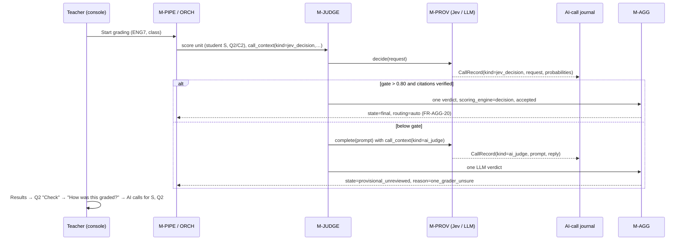

# Detailed Design Delta: Console Clarity — a test day the teacher can read

**Source:**
- The user's report from a live console run of the English test `ENG7-READ-01` (2026-10-20),
  six numbered items plus a general rule: *"the text in the console must be simple, clear and
  concise so it is super clear to the teacher. When pressing a button and something happens we
  need to see a clear indication that the operation was executed without the need to scroll.
  Error messages must be super clear. Instructions must be super clear. Results must be super
  clear."* — and: *"The env must be default in the config so its easier to operate"*
  (`HARNESS_ORCH_ESCALATION_BUDGET = 1.0`, `HARNESS_ORCH_RANDOM_ARM_RATE = 0`).
- The user's decision (2026-10-20) on why every answer read "Not final yet": **a Jev decision
  above its confidence threshold is final with one grader** (ADR-50).
- `docs/design/console_teacher_corrections_delta.md` v1.14-delta, on top of which this applies.

**Code baseline validated against:** `main` @ `813a009` (PR #804).
**Version:** 1.15-delta  **Date:** 2026-10-20  **Status:** Draft — design only; nothing here is
implemented yet.

## Revision history

| Version | Date | Change | Author |
|---|---|---|---|
| 1.15-delta | 2026-10-20 | **Console clarity.** Clarity rules for every teacher-facing string and action (FR-UI-23…25, FR-CONSOLE-71); missing pieces asked as plain questions (FR-AUTHOR-31/32); the whole package shown before approval and a visible approval (FR-CONSOLE-72…74, FR-UI-26/27); the package switcher names the package (FR-UI-28); elapsed time for every long stage (FR-CONSOLE-75, FR-UI-29); results by question, with points and a "Total grade" (FR-CONSOLE-76, FR-UI-30…33); a confident Jev decision is final (FR-AGG-20, FR-ORCH-45, amends FR-AGG-07 and FR-JUDGE-37); orchestration knobs read from the config file (FR-CONF-36/37); every AI call journaled and viewable (FR-PROV-44…46, FR-CONSOLE-77…79, FR-UI-34/35, FR-HELP-07). ADR-50…53. **No store migration.** | `/detailed-design-generator`, from the teacher's run |
| 1.15-delta r6 | 2026-10-21 | User decision after the #814 test agent found that F-ADV-INJ-DECISION (Jev fooled: top band, 0.99, real citations) would become final: **a confident Jev decision is final only when one LLM judge confirms its band** (FR-JUDGE-39). On disagreement Jev's verdict is set aside and the judge's verdict takes the ordinary path. FR-AGG-20, CT-JUDGE-14/FR-JUDGE-37 and ADR-50 amended; TC-JUDGE-46 amended, TC-JUDGE-47 added. | user, via `/work-backlog` finding |
| 1.15-delta r5 | 2026-10-20 | User confirmation: when Jev is below its gate, the original escalation logic is unchanged (several judges from different model families, median-band vote). FR-ORCH-45 now says this outright; TC-ORCH-62 holds it. | `/detailed-design-generator` |
| 1.15-delta r4 | 2026-10-20 | Gaps found while writing the test plan, now decided: FR-UI-31's rounding rule; FR-ORCH-45, where a Jev-final cell widened by the random arm falls back to the panel rule; FR-CONSOLE-71, where `teacher_text()` takes a version resolver. | `/create-test-plan` findings |
| 1.15-delta r3 | 2026-10-20 | User rule: *"whenever an input is required from the teacher … there must be a clear guidance on the format of the expected response (e.g. number 0-10). clarity is key."* Added FR-UI-36: every input on every screen shows a label, a format line with its limits, and an example; the format line and the validation share one definition; a census covers every input. | `/detailed-design-generator` |
| 1.15-delta r2 | 2026-10-20 | §9's open questions answered by the user. The AI-calls view leads with the Jev and judge request and response (FR-UI-35). *pass / not yet* is used only when no grade table exists. The blind-sample rate is unchanged. The view works on real classes. Advisor review fixes: CT-AGG-23 and CT-JUDGE-07 are amended explicitly; a Jev-final cell's confidence is its gate value; the knob is frozen in `RunConfig`; the lowest grade's floor is 0 and never asked; stage timings go to `run_metrics`; the version number comes from `revision`; the journal is one process-wide slot. | `/detailed-design-generator` |

---

## 1. What the teacher met, and why

Every row was reproduced by reading the code at `813a009`. "Cause" names the line that makes it
happen, so the fix lands at the cause rather than at the symptom.

| # | What the teacher saw | Cause at `813a009` | Fix |
|---|---|---|---|
| T0a | Had to set two environment variables in PowerShell before a small class would run | `HARNESS_ORCH_ESCALATION_BUDGET` / `HARNESS_ORCH_RANDOM_ARM_RATE` are read **only** from `os.environ` (`orch/settings.py:66,78,125`); the config file has no key for them, so the deployment tutorial (§8.4) tells the operator to export them | FR-CONF-36/37 |
| T0b | After a button press, nothing visible changed; the outcome was further down the page | `ActionOutcome` renders where the screen's body puts it, often below the fold; there is no single rule for where an outcome appears | FR-UI-24 |
| T1 | *"The grade table — the document names the grade but states no boundary for it, and a boundary is never invented (FR-AUTHOR-08)"* | `author/spec.py:113–116` writes the gap's `reason` as engineering prose with a requirement ID; the screen shows `reason` as the prompt. Requirement IDs appear in about 1,100 string literals under `src/aeh` (most are docstrings, but some reach responses, e.g. `Results.tsx:194`'s *"a no-op (FR-CONSOLE-02)"*) | FR-UI-23, FR-CONSOLE-71, FR-AUTHOR-31/32 |
| T2a | The package shown for approval did not include the approver or the passing grade just answered | The review read lists the draft's questions and gaps; answered gaps leave the gap list and are shown nowhere in the summary | FR-CONSOLE-72, FR-UI-26 |
| T2b | After **Approve**, no visible confirmation. A second press said *"the draft was already approved as ENG7-READ-01 ENG7-READ-01@e34abeaceb0a: …"* | The approve outcome was below the fold (T0b), the button stayed live, and the repeat-press text (`authoring_actions.py:613`) leads with an internal version hash | FR-CONSOLE-73/74, FR-UI-27 |
| T3 | The package switcher read **"Test package"**, not **ENG7-READ-01** | `wizard/vocabulary.ts:116` `packageLabel()` never uses the id. Its comment assumes ids are internal `pkg-…`, but a published package's id **is** the test name printed on the sheets | FR-UI-28 |
| T4 | No idea how long drafting, reading papers or grading took | Jobs carry `started_at`/`finished_at` (`console/jobs.py:34–57`) and the Jobs screen shows a duration, but the screen that started the work shows none; the run summary has no per-stage time | FR-CONSOLE-75, FR-UI-29 |
| T5a | No points per question; the total was labelled just **"Total:"** | The results read carries a **band** per rubric line (`criterion_band`) and a total, but no awarded/max points and no question mapping (`Results.tsx:324`) | FR-CONSOLE-76, FR-UI-30 |
| T5b | Every answer read *"Not final yet — awaiting teacher review"*, with no reason and no visible way to approve | **By construction, not by accident:** a Jev decision fills one judge seat (`judge/decision_engine.py:352–371`), and a one-verdict cell is always `provisional_unreviewed` (`agg/aggregate.py:281–287`, FR-AGG-07, FR-JUDGE-37(c)). The shipped one-judge config therefore makes **every** judged ENG7 answer provisional on every run. The approval exists (Review screen; **Finalize this batch** on Results) but is neither explained nor prominent | FR-AGG-20, FR-ORCH-45, FR-UI-32/33 |
| T5c | The bar chart counted rubric score levels across every rubric line together, which means nothing to a teacher | `Results.tsx:51–105` pools `criterion_band` of all lines into one histogram of level names | FR-UI-31 |
| T6 | No way to see what the AI was asked and what it answered | Nothing persists a request or reply. `CT-PROV-11`: the provider layer writes nothing; `PromptPayload` "is never logged"; `decision_prescreen` keeps Jev's probabilities but not the request; the Logs screen shows stage summaries only (`CT-CONSOLE-09`) | FR-PROV-44…46, FR-CONSOLE-77…79, FR-UI-34, FR-HELP-07 |

## 2. Module inventory delta

No new module. Touched modules and what each gains:

| Module | Gains |
|---|---|
| `M-UI` | Clarity rules (FR-UI-23…25), approve summary and state (FR-UI-26/27), package switcher name (FR-UI-28), elapsed clock (FR-UI-29), results by question (FR-UI-30…33), AI-calls view (FR-UI-34) |
| `M-CONSOLE` | The teacher-text boundary (FR-CONSOLE-71), package summary and approval reads (72…74), stage timings (75), question-level results (76), AI-call journal sink, read and CLI (77…79) |
| `M-AUTHOR` | Gaps as questions with an answer type and range (FR-AUTHOR-31/32) |
| `M-AGG` | Jev-final rule and the not-final reason code (FR-AGG-20) |
| `M-ORCH` | A Jev-final cell is not escalated (FR-ORCH-45) |
| `M-CONF` | Orchestration knobs as config keys (FR-CONF-36/37) |
| `M-PROV` | One call record per model call to an injected journal (FR-PROV-44…46) |
| `M-INGEST`, `M-EXTRACT`, `M-JUDGE`, `M-SYNTH`, `M-AUTHOR`, `M-HELP` | Each sets the call context around its provider calls (FR-PROV-45) |
| `M-STORE` | Purge removes the class's journal folder (FR-CONSOLE-77, CT-STORE-10 amended) |

The dependency graph is unchanged. `M-CONSOLE` already depends on `M-PROV` (through
`M-PIPE`'s composition root), `M-AGG` and `M-AUTHOR`.

## 3. Requirements

### 3.1 Clarity rules for every screen (item 0, item 1)

| ID | Requirement | Module |
|---|---|---|
| FR-UI-23 | No teacher-facing text — screen copy, API `detail`/`reason`/`next_action`/`question` fields, toasts, dialogs, badges — shall contain a requirement or test ID (`FR-`, `NFR-`, `CT-`, `TC-`, `ADR-`, `RS-` followed by an ID), a package-version hash (`@` followed by 12 hex), an internal reference (`pkg-…`, `sub-…`, a `work_id`, a `run_id` UUID), a file path, or a TOML fragment. The check is a text scan over every SPA screen in the bundle **and** every response of the console API's read and action matrix (the RS-08 method), and it fails on any hit. | `M-UI`, `M-CONSOLE` |
| FR-CONSOLE-71 | **The teacher-text boundary.** Every string field the console API returns for display shall pass through one function, `teacher_text()`, that (a) removes a parenthetical whose contents are only requirement IDs — `" (FR-AUTHOR-08)"` → `""`, `" (FR-PKG-28, CT-PKG-03)"` → `""`; (b) replaces a package-version id with its teacher label (FR-CONSOLE-74), through a `version_label` resolver passed in by the caller (the function itself is pure and reads no store); and (c) leaves everything else untouched. It is a safety net, not the fix: the strings a teacher meets most (the authoring gaps, the approve outcomes, the results and finalize dialogs) are rewritten at source by FR-AUTHOR-31, FR-CONSOLE-73 and FR-UI-33. FR-UI-23's scan runs on the output, so a string that leaks through some other route still fails. | `M-CONSOLE` |
| FR-UI-24 | **Every action shows its outcome without scrolling.** When any control action returns (accepted, refused, or dispatched as a job), the screen shall (a) show the outcome in a banner fixed at the top of the content area, inside the viewport at the scroll position the click was made from, which stays until dismissed or until the next action; (b) raise a toast; and (c) change the pressed control's state — disabled with a spinner while the request is in flight, then relabelled or replaced when the action is one-shot (FR-UI-27). A census test drives every action in `controls_payload()` through the SPA at a 1280×720 viewport, scrolled to the action's button, and asserts the banner's bounding box is inside the viewport. | `M-UI` |
| FR-UI-25 | **Plain wording.** Every refusal or error shown to the teacher shall have three parts, each a full sentence in everyday words: **what happened**, **why**, and **what to do next** (the existing `what`/`why`/`next_action` shape, `CT-CONSOLE-33`). Every outcome names the thing it acted on by its teacher name (the test name, the student's name, the class name, FR-UI-22) and never by an internal reference. The shared vocabulary (`console/vocabulary.py`, `ui/src/wizard/vocabulary.ts`) is the single source of these words. A refusal whose `next_action` is empty fails the census. | `M-UI`, `M-CONSOLE` |

| FR-UI-36 | **Every input says what it expects.** Every control where the teacher types or chooses something — text boxes, number fields, file pickers, dropdowns, every screen (authoring answers, class and student names, roster upload, papers upload, review marks and comments, amendments, key correction, settings such as the cost limit, search boxes excepted) — shall show, **before** the teacher types: (a) a label naming what to enter, in plain words; (b) a format line directly under the field giving the expected form and its limits, for example *"A whole number from 0 to 10"*, *"Your full name, as students know you"*, *"A PDF file, one per student"*, *"An amount in US dollars, for example 5 or 12.50"*; and (c) where useful, an example in the placeholder (*"e.g. 6"*). The format line and the field's validation share one definition (`answer_kind` with `min`/`max`/`pattern`/`accept`, served by the API where the limits depend on data, such as a test's maximum points), so the guidance can never state a range the check does not enforce. A wrong entry is refused **at the field**, before anything is sent, in red beside it, restating the format line (*"Please enter a whole number from 0 to 10."*). The field keeps what was typed, and the submit button says why it is disabled. Census: an SPA test walks every screen and asserts that every `input`, `select` and `textarea` that is not a search box has a visible label and a non-empty format line linked by `aria-describedby`, and that each `whole_number` field refuses `min-1`, `max+1` and `"abc"` with its format line. | `M-UI`, `M-CONSOLE` |

### 3.2 Plain questions for missing pieces (item 1)

| ID | Requirement | Module |
|---|---|---|
| FR-AUTHOR-31 | Every in-draft gap shall carry, beside its engineering `reason` (kept for the audit record, never displayed), three teacher fields: `question` (one plain sentence ending in `?`), `answer_hint` (the form of the answer, in words), and `answer_kind` (`text`, or `whole_number` with integer `min` and `max`). The authoring screen shows **only** `question` and `answer_hint`, one question at a time, under the heading **"A few questions before you approve"** with a count ("Question 1 of 2"). An answer outside the kind or range is refused **at the field**, before submission, with the hint restated ("Please enter a whole number from 1 to 8."). The server re-applies the same check when the answer is saved (`CT-AUTHOR-27`). | `M-AUTHOR`, `M-CONSOLE`, `M-UI` |
| FR-AUTHOR-32 | The fixed questions, by gap: **approver** → *"Who is approving this test? Type your name."* (`text`, 1–80 characters). **One grade with no boundary** (`grades <name>`) → *"What is the lowest total score that earns '<name>'?"*, hint *"A whole number from <lo> to <max>. The test is out of <max> points."* (`whole_number`, `max` = the sum of the questions' points, `lo` = one more than the next-lower grade's floor, or 1). The **lowest** grade in the table (ENG7's *not yet*) is never asked: its floor is always 0 and is filled in automatically. Floors must rise strictly up the table. An answer that breaks the order is refused at the field: *"'pass' must need more points than 'not yet' (0). Please enter a number from 1 to 8."* **No grade table at all** (`grades`) → *"What is the passing score for this test?"*, hint *"A whole number from 1 to <max>. A student with this score or more passes."* (`whole_number`, 1..max). The answer builds a two-grade table, `pass` = the answer and `not yet` = 0 (Assumption; see Q2). **Question type** → *"Is question <n> multiple choice?"* (yes/no, then its options). **Question points** → *"How many points is question <n> worth?"* (`whole_number`, 1–100). `<max>` is computed from the draft's own question points, so the hint and the check always match the test in hand. When a question's points are themselves missing, the grade question waits until they are answered and then states the max. | `M-AUTHOR` |

### 3.3 The package shown whole, and an approval that is seen (item 2)

| ID | Requirement | Module |
|---|---|---|
| FR-CONSOLE-72 | The draft review read shall return a **package summary** of the draft as it would be published, with every teacher answer merged in: the test name, the approver, each question in paper order (number, text, points, type, and for multiple choice the correct option), each rubric line under its question (its score levels with points), the grade table (each grade and its lowest total, with the test's maximum), and the total points. A value the teacher supplied carries `source: "your answer"`; one read from the documents carries `source: "from the documents"`. Unanswered pieces appear in place as *"Not answered yet"*. | `M-CONSOLE` |
| FR-UI-26 | The approve screen shall render FR-CONSOLE-72's summary **above** the Approve button, in this order: **Test**, **Approved by**, **Passing score** (or the grade table), **Questions** (with points; total at the end), **How each question is scored**. Values from the teacher's answers are marked "your answer". The Approve button is disabled, with the reason beside it, while any piece is unanswered. | `M-UI` |
| FR-CONSOLE-73 | A successful approve shall return an outcome naming what was published, in teacher words: *"Published ENG7-READ-01, version 1. Approved by <name> on 20 Oct 2026. Next: load the students' papers."*, with a `next` link to Load papers. A press on a draft that is already approved and unchanged is **not** a refusal: it returns the same success outcome prefixed *"Already published —"*, with no hash and no instruction to edit. | `M-CONSOLE` |
| FR-CONSOLE-74 | **Teacher label for a package version.** A package version is named *"<package> version <n>"*, where `n` = `package_version.revision + 1` (the column is `revision >= 0`; `package_version` has no timestamp). Where a date helps, it is followed by *"(approved <date>)"*, with the date from the package's approval record. The `<package>@<hash>` form is internal: it appears in no teacher-facing text (FR-UI-23) and stays in exports, logs and the API's id fields. | `M-CONSOLE` |
| FR-UI-27 | After a successful approve, the screen shall replace the Approve button with a success panel (FR-UI-24's banner) reading FR-CONSOLE-73's text, plus a primary button **"Load papers"**. The draft cannot be approved again from that screen until it is edited. | `M-UI` |

### 3.4 The package switcher names the package (item 3)

| ID | Requirement | Module |
|---|---|---|
| FR-UI-28 | The context header's package switcher shall label each option with the package's name (its `package_id`, which is the test name printed on the sheets), followed by *" — version <n>"* when the package has more than one version. The ordinal fallback (*"Test package 2"*) applies only to an id matching the internal pattern `^pkg-`. The switcher's own label stays **"Test package"**. The SPA test asserts that, with `ENG7-READ-01` published, the option text is exactly `ENG7-READ-01`. | `M-UI` |

### 3.5 How long each long step took (item 4)

| ID | Requirement | Module |
|---|---|---|
| FR-CONSOLE-75 | Every long operation shall report its timing: each job (drafting a package, reading papers) carries `started_at` and `finished_at` (already true, `jobs.py`), and each grading run's results read carries `stage_timings`, a list of `{stage, label, seconds}` in run order, for the stages the run executed: *Reading answers* (extract), *AI grading* (judge, Jev and LLM together), *Combining grades* (aggregate), *Writing feedback* (synth). `StageTrace` (`pipeline/results.py:20`) has **no** timestamps today, so `M-PIPE` gains them. Each stage it drives is timed with the run's clock seam, and the result is written as a `run_metrics` row `stage_seconds.<stage>` (the existing EAV table; no migration), summed across passes and resumes. A stage that did not run is absent, never shown as `0 s`. | `M-CONSOLE` |
| FR-UI-29 | The screen that started a long operation — **Author the package** (drafting), **Load papers** (reading papers), **Start grading** / **Monitor** (the run) — shall show, while it runs, *"Working — 1 min 12 s"*, a clock that ticks each second from `started_at`. When it ends it shows *"Done in 2 min 14 s"* (or *"Stopped after …"* / *"Failed after …"*) in FR-UI-24's banner. The Results screen shows a one-line **"Time taken"** row per stage from `stage_timings` and the run's total. Durations under a minute read *"45 s"*, under an hour *"2 min 14 s"*, otherwise *"1 h 5 min"*. | `M-UI` |

### 3.6 Results a teacher can read (item 5)

| ID | Requirement | Module |
|---|---|---|
| FR-CONSOLE-76 | The results read shall add, per student: `questions`, a list in paper order of `{question_id, label, points_awarded, points_max, state, not_final_reason}`, where a question's points are the sum over its **top-level** rubric lines. An evidence-checklist composite (FR-PKG-24) is counted once, through the composite; its aspects are never summed again. Also per student: `total_points`, `total_max` and `grade` (the grade table's name for the total). Per run: `question_stats`, a list of `{question_id, label, points_max, mean_points, full_marks, zero_marks, graded}` in paper order. The existing per-criterion fields stay for the detail view. | `M-CONSOLE` |
| FR-UI-30 | The Results screen shall show one row per student: the name (FR-UI-22), one cell per question reading *"Q1 · 2 / 2"*, and a column headed **"Total grade"** reading *"6 / 8 — pass"*. A question that is not final shows its points with a "Check" badge whose tooltip and expanded text give the reason (FR-UI-32). A student's detail page lists each question with its points, the rubric level awarded per line, and a **"How was this graded?"** link (FR-UI-34). | `M-UI` |
| FR-UI-31 | The Results overview statistics shall be **per question**: a bar per question showing the class's average as a percentage of that question's points, labelled *"Q2 — average 1.8 / 3 (58%)"*. Rounding rule: the average is shown to one decimal place, round-half-up, from the unrounded mean. The percentage is the unrounded mean ÷ max × 100, rounded half-up to a whole number. So a mean of 1.75 of 3 reads "1.8 / 3 (58%)". It is shown with *"full marks: 2 of 4 students"* and *"no marks: 0"* beneath. A second bar chart shows how many students got each grade (*pass*, *not yet*). The pooled rubric-level histogram is removed. The per-rubric-line level counts move into each question's expandable detail. | `M-UI` |
| FR-AGG-20 | **A confident Jev decision is final.** Amends FR-AGG-07's single-judge clause and narrows FR-AGG-19's engine-blindness for this one case. A cell whose verdicts are exactly one, where that one has `scoring_engine = 'decision'`, is written `state = 'final'`, `routing = 'auto'`, with note *"decided by the decision engine above its confidence threshold"*. No join is needed: only an accepted **and confirmed** decision becomes a verdict (`judge/worker.py:357`, FR-JUDGE-39), so the gate has already exceeded the threshold (FR-JUDGE-27), the citations have already verified (FR-JUDGE-30), and one LLM judge has already given the same band. The cell's recorded `confidence` is the decision's gate value (the figure that made it final, always above the threshold), not the single-judge prior (0.50–0.75). A consumer that compares confidence with the threshold therefore agrees with the route. A single verdict from an LLM judge stays `provisional_unreviewed` exactly as today. The rule is gated by `HARNESS_JEV_FINAL_ON_ACCEPT` (default `true`; `false` restores FR-AGG-07 unchanged). The knob is **frozen into `RunConfig`** with the other decision keys (`DECISION_KEYS`) and recorded on the run row, so a resumed run grades every cell by one rule whatever the environment says at resume. Every `provisional_unreviewed` or `queued` cell carries a `not_final_reason` code from a closed set: `one_grader_unsure` (single LLM verdict, including Jev below its gate), `graders_disagree` (panel spread or low agreement), `evidence_not_found` (evidence-required cap fired), `quote_not_verified` (citation failed), `more_graders_unavailable` (escalation wanted, no seat), `graders_refused` (breaker). | `M-AGG` |
| FR-JUDGE-39 | **Confirmation of a confident Jev decision.** On the decision seat, when the decision engine accepts (gate above threshold, citations verified) and `HARNESS_JEV_FINAL_ON_ACCEPT` is true, the worker also runs the seat's LLM judge (`RunConfig.panel[0]`, a model outside the decision engine's family) on the same unit, with exactly the request it sends with the engine off (CT-JUDGE-22). (a) **Same band:** the unit's verdict is the decision verdict (`scoring_engine='decision'`, `prescreen_outcome='accepted'`), with the judge's band recorded as `confirmed_by` (judge id and band) on the prescreen record. (b) **Different band:** the unit's verdict is the LLM verdict (`scoring_engine='llm'`, `prescreen_outcome='unconfirmed'`), and Jev's answer stays in the prescreen record and the AI-call log; the cell then takes the ordinary single-LLM path (provisional, `should_escalate`, 1 → 3). (c) **Judge call fails:** the unit fails exactly as an LLM-path unit fails today (retry, then the existing terminal-failure handling); a decision verdict never becomes final unconfirmed. With the knob false, the seat behaves as before this delta (Jev's accepted answer is the verdict, provisional by FR-AGG-07, and no confirmation call is made). Each unit still yields exactly one verdict, so panel sizes and the odd-panel rule are unchanged. Both calls are journaled (`jev_decision`, `ai_judge`). Cost: one judge call per Jev-accepted answer. | `M-JUDGE` |
| FR-ORCH-45 | A cell final under FR-AGG-20 is not an escalation candidate: `enqueue_escalation` is not called for it, and it consumes no escalation budget. The random arm (FR-ORCH-11) still draws independently of this rule (CT-ORCH-15) when its rate is above 0. **FR-AGG-20 holds only while the cell has exactly one verdict.** When the random arm widens a Jev-final cell, its next aggregation uses the ordinary panel rule over all its verdicts, engine-blind (CT-AGG-23), so it ends `final` or not by the panel's agreement, like any widened cell. More graders can only add scrutiny. With the shipped `orch_random_arm_rate = 0`, this never happens. **Every other cell escalates exactly as before this delta.** That includes a cell where Jev fell below its gate or failed citation verification, so the seat's LLM judge answered. The base panel depth per scoring model (one judge for atomic criteria, three for holistic ones), the `should_escalate` policy and its signals (FR-AGG-08), the odd-panel ladder 1 → 3 → 5 (FR-ORCH-10), the median-band panel rule over a multi-judge panel, the budget admission (FR-ORCH-14) and the seat check are all unchanged. FR-AGG-20 removes Jev-final cells from the candidate set and adds nothing else. | `M-ORCH` |
| FR-UI-32 | Each not-final reason code shall render as one plain sentence: `one_grader_unsure` → *"The AI grader was not sure. Please check this answer."*; `graders_disagree` → *"The AI graders gave different marks. Please choose the right one."*; `evidence_not_found` → *"The grader could not find the answer in the student's writing. Please check the page."*; `quote_not_verified` → *"The grader quoted words that are not on the page. Please check this answer."*; `more_graders_unavailable` → *"A second opinion was needed but no other grader is set up. Please check this answer."*; `graders_refused` → *"The AI could not grade this question for the class. Please grade it yourself."* | `M-UI` |
| FR-UI-33 | **Approving grades.** When any grade in the run is not final, the Results screen shall open with a banner at the top: *"<k> answers need your check before the grades are final."* with two buttons: **"Check answers"** (the Review screen, filtered to this run) and **"Approve all grades"** (the existing finalize-batch action, renamed). The confirmation reads: *"Approve all grades for <class> — <test>? <k> answers you have not checked will be accepted as the AI graded them. You can still change a grade afterward; the change is recorded."* When every grade is final, the banner reads *"All grades are final."* **Required end state:** after a successful Approve all, no question of that run's results reads "Check" or "Not final". Note: `finalize_batch` (`grade/finalization.py:135`) settles `submission_grade` rows. Whether it also settles the per-question `criterion_score` states is **unverified**. If it does not, the results read derives a question's displayed state as final whenever its submission grade is final or its review item was acted on. The implementing story must confirm which, and must not show "All grades are final" over question rows still marked not final. An open review window (FR-CONSOLE-22) delays finalization, and the banner then says so: *"Grades become final automatically on <date>, when the review window ends."* The words *finalize*, *batch*, *provisional* and *no-op* do not appear (FR-UI-23's scan includes this word list for the Results and Review screens). | `M-UI` |

### 3.7 Defaults in the config file (item 0)

| ID | Requirement | Module |
|---|---|---|
| FR-CONF-36 | The config file's profile section shall accept two plain keys (not `HARNESS_*` names; `HARNESS_KEYS` stays six, `TC-CONF-C11`): `orch_escalation_budget` (number in [0, 1]) and `orch_random_arm_rate` (number in [0, 1]). The value in force is, in precedence order: the environment variable (`HARNESS_ORCH_ESCALATION_BUDGET`, `HARNESS_ORCH_RANDOM_ARM_RATE`), then the config file, then the code default (0.30, 0.07, unchanged). Both `aeh run` and the console's start-run (`console/run_start.py`) use the resolved value. The start-up banner and Settings show each value with its source (*"from the config file"*). | `M-CONF`, `M-ORCH`, `M-CONSOLE` |
| FR-CONF-37 | The shipped live-test config (`docs/live-tests/config/live-test.dev-ci.toml`) and `config/harness.example.toml`'s `dev-ci` section shall set `orch_escalation_budget = 1.0` and `orch_random_arm_rate = 0`, each with a one-line comment saying why (a small class; a one-judge panel). The tutorials (deployment §8.4, console operating) drop the two `$env:` lines. | `M-CONF`, docs |

### 3.8 Every AI call, journaled and viewable (item 6)

| ID | Requirement | Module |
|---|---|---|
| FR-PROV-44 | Every provider implementation — `OpenRouterProvider`, `LocalServerProvider`, `JevOpenRouterProvider` (including the typesafe-SDK route), `OpenJevLocalProvider`, and `RecordedFixtureProvider` — shall emit one `CallRecord` per model call **attempt** (a retried call is several records, linked by `call_id` and `attempt`) to an injected `CallJournal` sink, after the attempt ends. Fields: `call_id`, `attempt`, `at` (UTC ISO-8601), `kind`, the context fields (FR-PROV-45), `model` (requested build), `resolved_build`, `request` (the assembled request: the `PromptPayload` fields in order, or the Jev decision request's questions and options), `response` (`Completion.text` verbatim, or the Jev answer probabilities), `outcome` (`ok`, `retried`, `malformed`, `rejected`, `failed`), `error` (the error class and message; no traceback), `tokens_in`, `tokens_out`, `latency_ms`, `cost`. A provider with no sink injected emits nothing, so the fast tier is unchanged except where a test injects one. | `M-PROV` |
| FR-PROV-45 | **Call context.** The kind of call and what it is about shall reach the provider through a context variable, `aeh.prov.call_context(kind=…, cohort_id=…, run_id=…, work_id=…, submission_id=…, criterion_id=…, package_id=…)`, a context manager set by the calling module around each provider call. The provider surface (`CT-PROV-01`) is unchanged. The kinds are: `page_reading` (M-INGEST transcriber), `package_drafting` (M-AUTHOR), `rubric_setup` (M-SETUP), `answer_extraction` (M-EXTRACT), `ai_judge` (M-JUDGE LLM path), `jev_decision` (M-JUDGE decision seat), `feedback_writing` (M-SYNTH), `help_question` (M-HELP). A call made with no context records `kind = "unlabelled"`. A fixture-provider run of the full pipeline asserts that no record is unlabelled. | `M-PROV`, callers |
| FR-PROV-46 | **What is never journaled:** the API key, any HTTP header, the provider's raw HTTP envelope, and image bytes. A page image is recorded as a descriptor, `"[page image: page 2 of 3, 812 KB, sha256 1a2b…]"`. Request bodies already carry `student_ref` and never a student name (`CT-PROV-13`). A transcription **response** can contain the name the student wrote on the sheet; that text is student data and is held as such (FR-CONSOLE-77). | `M-PROV` |
| FR-CONSOLE-77 | **The journal's home.** Providers are constructed in several places at `813a009`: `prov/factories.py:provider_for`, `pipeline/runtime.py`, `console/authoring_actions.py:297,385`, `console/help_read.py:92` and `console/run_start.py:184`. Injecting per construction would miss some. So `M-PROV` holds one **process-wide** journal slot, `aeh.prov.install_call_journal(sink)`, read at emit time, and each process entry point — `python -m aeh` (every subcommand) and the console server's start — installs it once with the data folder. The installed sink appends each `CallRecord` as one JSON line to `<data_dir>/logs/ai-calls/<cohort_id>/<YYYY-MM-DD>.jsonl`, or `<data_dir>/logs/ai-calls/_packages/<package_id>/<YYYY-MM-DD>.jsonl` for a call with no class (drafting, rubric setup), or `_help/` for help questions. The sink appends under a process lock with one `write` per line, flushed. A crash can lose at most the record being written and never corrupts earlier lines. A reader skips a torn last line. `purge_cohort` deletes the class's folder in the same operation (`CT-STORE-10`'s rule that nothing of a purged class survives). Retention otherwise follows the data folder: it is the teacher's machine. **Protection:** the journal lives inside the data folder, so it inherits NFR-STORE-05's platform encryption at rest where available. Requests carry `student_ref`, not names (FR-STORE-12's pseudonymization, CT-PROV-13). The one place a name can appear is a page-reading **response** (the header the student wrote), and that is the same text the cohort store already holds from intake. No clause of the base design or of the deltas forbids student text outside the store tables (checked: NFR-STORE-05, CT-STORE-10, CT-PROV-13). The console reads the files and does not import provider construction (TC-CONSOLE-36). | `M-CONSOLE`, `M-PIPE`, `M-STORE` |
| FR-CONSOLE-78 | `GET /api/v1/ai-calls` shall return journal records newest first, 50 per page, filterable by `run_id`, `cohort_id`, `package_id`, `kind`, `student` (name, FR-UI-22, resolved to the `student_ref`s it matches), `question_id` and `outcome`. Each item carries a teacher label for its kind (*"Jev decision"*, *"AI judge"*, *"Page reading"*, *"Package drafting"*, *"Answer finding"*, *"Feedback writing"*, *"Help question"*), the student's name, the question, the model, the time, the duration and the cost, plus `request` and `response` in full. | `M-CONSOLE` |
| FR-CONSOLE-79 | A CLI read, `python -m aeh logs ai-calls --data-dir <dir> [--run <id>] [--student "<name>"] [--question Q2] [--kind jev_decision] [--full]`, shall print the same records: one summary line per call, and with `--full` the request and response under it. `--json` prints the raw lines. | `M-CONSOLE` |
| FR-UI-34 | The Logs screen shall have two tabs: **Run steps** (today's stage records) and **AI calls** (FR-CONSOLE-78). Each AI-call row shows kind, student, question, model, time, duration and cost. Expanding it shows **"What the AI was asked"** and **"What it answered"** verbatim, monospace, with a Copy button each. For a Jev decision, the answer is shown as the band it chose and each band's probability, plus the confidence against the threshold (*"confidence 0.91, needed above 0.80 — accepted"*). Each question on a student's detail page has **"How was this graded?"**, which opens AI calls filtered to that student and question for that run, in call order. | `M-UI` |
| FR-UI-35 | The AI-calls view shall open filtered to the grading calls (`jev_decision`, `ai_judge`). Each expanded row is headed by what was graded (*"Dana Levi — Q2"*). Its two panels are titled **"Question sent to Jev"** and **"Jev's answer"** (or **"Question sent to the judge"** and **"The judge's answer"**), each verbatim. The view works the same for `synthetic` and `real` classes, with no consent filter and no extra confirmation (§9 Q4). | `M-UI`, `M-CONSOLE` |
| FR-HELP-07 | A tutorial, `docs/tutorials/logs-tutorial.md`, mirrored into `src/aeh/help_assets/manuals/logs-tutorial.md` and listed in the console's Help, shall explain in teacher words: what the log holds and why (every AI call: what it was asked, what it answered); how to open it (Logs → AI calls, and "How was this graded?" from a student); how to read a Jev decision and an AI-judge call; how to filter; where the files live and how to read them from a terminal (FR-CONSOLE-79); and that the log holds students' answers and is deleted with the class. It walks one real ENG7 answer from page reading to final mark, with screenshots from the live acceptance run (§7). | `M-HELP`, docs |

## 4. Contract changes

Classified under base §4.7. Contract versions are bumped where a clause is amended.

| Clause | Change | Class | Consumers to re-verify |
|---|---|---|---|
| CT-PROV-11 | Amend: "Writes nothing directly. Its counters … are read by `M-ORCH`. **When a `CallJournal` is injected, it emits one `CallRecord` per call attempt to it (FR-PROV-44) and does not itself write the record anywhere.**" | Additive (no sink → no change) | `M-ORCH`, `M-CONSOLE` |
| CT-PROV-14 | Amend: add "Per call attempt, when a journal is injected: one `CallRecord` with the FR-PROV-44 fields; the field names and `kind` vocabulary are contract." | Additive | ops, `M-CONSOLE` |
| CT-PROV-31 (new) | `security` · A `CallRecord` never contains an API key, an HTTP header, or image bytes (FR-PROV-46). | New | all |
| CT-PROV-32 (new) | `behaviour` · Every provider implementation, including the fixture provider, emits the same `CallRecord` shape for the same call (CT-PROV-02's substitutability extended to the journal). | New | `M-CONFORM`, `M-CONSOLE` |
| CT-AGG-24 (new) | `behaviour` · A one-verdict cell whose verdict is an accepted decision-engine verdict is `final`/`auto` when `HARNESS_JEV_FINAL_ON_ACCEPT` is true (FR-AGG-20); every other one-verdict cell is `provisional_unreviewed`. Every non-final cell carries a `not_final_reason` from FR-AGG-20's closed set. | **Breaking for FR-AGG-07's consumers**: CT-AGG v+1 | `M-GRADE`, `M-REVIEW`, `M-STATS`, `M-ORCH`, `M-CONSOLE` |
| CT-AGG-23 | Amend: "Aggregation, confidence and escalation are engine-blind (FR-AGG-19) **except for FR-AGG-20: a cell whose only verdict is a decision-engine verdict is final, with the gate value as its confidence.** Swapping `scoring_engine` on a verdict set of two or more changes no output field." | **Breaking**: CT-AGG v+1 | `M-GRADE`, `M-REVIEW`, `M-STATS` |
| CT-JUDGE-07 | Amend the Jev delta's addition: "The decision engine's calibrated confidence selects the engine for the decision seat (FR-JUDGE-27). It never selects a band or an escalation. **When it accepts, it does select the route: a lone accepted decision verdict is final (FR-AGG-20).**" | **Breaking**: CT-JUDGE v+1 | `M-AGG`, `M-ORCH` |
| CT-JUDGE-14 / FR-JUDGE-37 | Amend FR-JUDGE-37(c), the adversarial-parity property over CT-JUDGE-14's fixture set: "confidence cannot reach auto-accept on a single **LLM** verdict; a single decision-engine verdict reaches `final` only through the engine's gate, verified citations **and an LLM judge's confirming band** (FR-AGG-20, FR-JUDGE-39). For every injection case, either the recorded `decide` answer is below the gate or fails citation verification, or the recorded confirming judge gives a different band; an injection that fools both Jev and the judge is the documented residual risk." Also withdraw the Jev delta's §3 statement *"a Jev verdict alone never auto-accepts"* (its line 574), which this delta reverses. | Breaking (a safety property narrowed, ADR-50) | `M-AGG`, `M-CONFORM` |
| CT-CONSOLE-09 | Amend: the per-student prohibition applies to the **Run steps** log read (`/api/v1/logs`). The **AI calls** read (`/api/v1/ai-calls`) is a per-call audit view and names students by design (FR-CONSOLE-78). | Breaking (a non-promise becomes a promise for a new read) | `M-UI` |
| CT-CONSOLE-53 (new) | `data` · Every display string in every console API response has passed `teacher_text()` and matches no FR-UI-23 pattern. | New | `M-UI` |
| CT-CONSOLE-54 (new) | `data` · The results read's `questions[].points_awarded` sums to `total_points` for every student, and an evidence-checklist composite's aspects are counted once (FR-CONSOLE-76). | New | `M-UI` |
| CT-CONF-25 (new) | `config` · `orch_escalation_budget` and `orch_random_arm_rate` resolve environment > config file > code default, and the same resolved values reach `aeh run` and the console's start-run (FR-CONF-36). | New | `M-ORCH`, `M-CONSOLE` |
| CT-STORE-10 | Amend: "… and the class's AI-call journal folder (FR-CONSOLE-77)." | Additive | `M-CONSOLE` |
| CT-AUTHOR-27 (new) | `behaviour` · A gap answer of `answer_kind: whole_number` outside `[min, max]` is refused with the gap's `answer_hint`, and nothing is written (FR-AUTHOR-31). | New | `M-CONSOLE`, `M-UI` |

## 5. Design decisions (ADRs)

**ADR-50 — Trust a confident Jev decision.** *Context:* with a one-judge panel, FR-AGG-07 makes
every judged answer provisional, so a normal run ends with nothing final, and the teacher reads
that as a failure (T5b). *Options:* (a) ship three judges by default, so confident agreement is
final; (b) keep one judge and make teacher approval of every answer the main step; (c) treat an
accepted Jev decision as final. *Decision:* (c), the user's choice of 2026-10-20, **amended 2026-10-21: final only when one LLM judge confirms Jev's band (FR-JUDGE-39)**, after the adversarial fixture showed a fooled Jev would otherwise reach final. *Consequences:*
fewer answers need a teacher, and cost is the lowest. The safety property FR-JUDGE-37(c) gave —
"a prompt injection can never reach auto-accept on one grader" — becomes conditional on Jev's
gate and on citation verification. Mitigations: an LLM judge from another model family must give the same band (FR-JUDGE-39), so an injection must fool two model families; citations must verify before acceptance
(FR-JUDGE-30, unchanged); the adversarial fixture set must stay below the gate (amended
FR-JUDGE-37); the blind sample (M-REVIEW, FR-REVIEW-14) still draws from complete final grades (`review/blind.py:164`), which now include Jev-final marks; every Jev-final mark is
explained in the AI-call log (FR-UI-34); and `HARNESS_JEV_FINAL_ON_ACCEPT=false` restores the old
rule. An answer Jev cannot decide falls back to one LLM judge and is still provisional, with the
reason *"The AI grader was not sure."*

**ADR-51 — The AI-call journal is JSON-lines files under the data folder, not a store table.**
*Context:* calls happen with no run (drafting, page reading), with no class (drafting, help), and
from six modules; a cohort-tier table would need a migration owned by one module, it would miss
calls with no cohort, and it would lengthen every write transaction with large text. *Decision:*
append-only `.jsonl` per class per day (FR-CONSOLE-77), written by a sink the composition root
injects. *Consequences:* no migration and no change to the migration chain; purge deletes a
folder; the console reads it by streaming files. Filtering is a scan over one class's files (no
volume target, §9 Q1; the live walk records the real count). The journal is not
transactional with the grade it explains. A crash between a call and its grade write leaves a
record with no grade, which the log shows as a call that led nowhere, and that is true.

**ADR-52 — Call context through a context variable, not a new parameter.** *Context:*
`complete(prompt, model_ref, params)` is a contract with every caller (CT-PROV-01), and the
journal needs to know what each call is about. *Decision:* `call_context()` sets a
`contextvars.ContextVar` that the provider reads when it emits a record. It is set inside the
worker function, so it is correct under the orchestrator's thread pool. *Consequences:* no
surface change. A caller that forgets the context is caught by FR-PROV-45's "no unlabelled
record" test rather than at compile time.

**ADR-53 — A boundary filter plus a census, not a hand edit of every string.** *Context:* about
1,100 source string literals carry requirement IDs, and many are deliberately engineering-facing
(CLI output, audit records, exceptions). *Decision:* rewrite at source the strings a teacher meets
most (the authoring gaps, the approve and finalize texts), pass every console display field
through `teacher_text()` (FR-CONSOLE-71), and let FR-UI-23's scan over every API response and
screen be the gate. *Consequences:* engineering surfaces keep their traceability. A new
teacher-facing string that leaks an ID fails a test instead of reaching a teacher.

## 6. Data flow — how one ENG7 answer is graded and explained



## 7. The live acceptance walk (real OpenRouter)

This is the run the user asked to see work. It becomes the acceptance case for this delta in the
test plan, and it runs after implementation, against real OpenRouter, with the key loaded from
`.env-dev` (never echoed or committed), a fresh data folder, the shipped `live-test.dev-ci.toml`
(cost ceiling 5 USD), and **no** `$env:HARNESS_ORCH_*` lines. Each step lists the text the
teacher must see. A step passes only if that text is visible **without scrolling** at 1280×720.

| # | Teacher does | Must see (exact or pattern) |
|---|---|---|
| 1 | Start the console with the shipped config | Banner/Settings: *"Second-opinion budget: 100% (from the config file)"*, *"Random extra-grader sample: off (from the config file)"* |
| 2 | Create class *eng7-class* from the roster | *"Class eng7-class created — 4 students."* |
| 3 | Author the package from the four ENG7 PDFs | While drafting: *"Working — <n> s"*; then *"Done in <t>"* |
| 4 | Answer the questions | *"A few questions before you approve"*, *"Question 1 of 2: Who is approving this test? Type your name."*; then *"What is the lowest total score that earns 'pass'?"* (if the documents omit it) with *"A whole number from 1 to 8."*; entering 9 shows *"Please enter a whole number from 1 to 8."* at the field |
| 5 | Review the package | Summary shows **Test** ENG7-READ-01, **Approved by** <name> *(your answer)*, **Passing score** 6 of 8, **Questions** Q1 2, Q2 3, Q3 3, total 8; no `FR-`/`@hex` anywhere |
| 6 | Approve | Top banner: *"Published ENG7-READ-01, version 1. Approved by <name> on <date>. Next: load the students' papers."*; Approve replaced by **Load papers** |
| 7 | Look at the header | Test switcher shows **ENG7-READ-01** |
| 8 | Load the test paper and the four answer sheets | *"Working — …"*, then *"Done in <t>. 4 papers read, all matched."* |
| 9 | Start grading | Monitor: *"Working — …"*; on finish *"Done in <t>"* |
| 10 | Open Results | Per student: *"Q1 · x / 2"*, *"Q2 · x / 3"*, *"Q3 · x / 3"*, **Total grade** *"y / 8 — pass"*; *Time taken* per stage; per-question bars; grade-count bars; a banner that is either *"All grades are final."* or *"<k> answers need your check…"* with **Check answers** / **Approve all grades** |
| 11 | On any answer marked "Check" | One of FR-UI-32's sentences |
| 12 | Click **How was this graded?** for a Jev-final answer | AI calls, already filtered to grading calls: *"<student> — Q2"*, **Question sent to Jev** (verbatim), **Jev's answer** (band probabilities), *"confidence 0.9x, needed above 0.80 — accepted"*. For a fallback answer: **Question sent to the judge** and **The judge's answer** |
| 13 | **Approve all grades** | Confirmation in FR-UI-33's words; then *"All grades are final."* |
| 14 | Run `python -m aeh logs ai-calls --data-dir <dir> --student "<name>" --full` | The same calls as step 12 |

What the run records for the delta's open numbers: each stage's real duration, the share of ENG7
answers Jev decided (final) versus fell back, and the run's cost. These replace the Assumptions
below.

## 8. Known limits

- A Jev-final mark is one grader's mark. The teacher can still amend it, and the amendment is
  recorded; the blind sample still checks a sample of final marks.
- The journal is not transactional with grades (ADR-51).
- The AI-call view shows student answers in full. It is for the teacher and operator on the
  machine that holds the data, and it is behind the same console access as every other screen.
- Help questions (FR-CONSOLE-77 `_help/`) are not deleted by a class purge, because they belong to
  no class.

## 9. Decisions on the open questions (user, 2026-10-20)

| # | Question | Decision |
|---|---|---|
| Q1 | How large must the journal be, and what must the view show? | *"I just want to see the question sent to Jev (or the judge) and its response."* No volume target is set. The AI-calls view opens filtered to the **grading calls** (`jev_decision`, `ai_judge`), and each row expands to two panels, **"Question sent to Jev"** / **"Question sent to the judge"** and **"Jev's answer"** / **"The judge's answer"**, verbatim (FR-UI-34). The other kinds are still journaled and reachable through the kind filter, but are not shown by default. |
| Q2 | When the documents state no grades at all, is a two-grade *pass / not yet* table the right default? | Yes, when appropriate: only when the documents state no grade table at all (FR-AUTHOR-32). A document that names its own grades keeps them. |
| Q3 | Should Jev-final marks count in the blind sample at a higher rate? | No. The sample rate is unchanged. |
| Q4 | Real (non-synthetic) classes: may the teacher see Jev's and the judge's request and response? | **Yes.** The AI-calls view and "How was this graded?" work on every consent class (`synthetic` and `real`) and every provider (OpenRouter, local, OpenJev, fixture), with no extra confirmation. FR-CONSOLE-78 applies no consent filter. A test reads a `real` class's Jev call through the view (FR-UI-34). |

## 10. Handoff

This delta is stage 1. Next:

```bash
/create-test-plan docs/design/console_clarity_design_delta.md
```

The test plan should carry the `CT-*` changes in §4 as its contract and regression layer:
CT-AGG-24 and the amended FR-JUDGE-37 are breaking, so `M-GRADE`, `M-REVIEW`, `M-STATS`,
`M-ORCH` and `M-CONSOLE` re-verify. Also needed: FR-UI-23's census and FR-UI-24's viewport
census over **every** action, and §7's live walk as the acceptance journey. Then
`/plan-to-issues` turns both into story/test pairs. The order the dependencies suggest:
FR-CONF-36/37 and FR-AGG-20 first (they make the run behave), then the call journal
(FR-PROV-44…46, FR-CONSOLE-77), then the screens.
