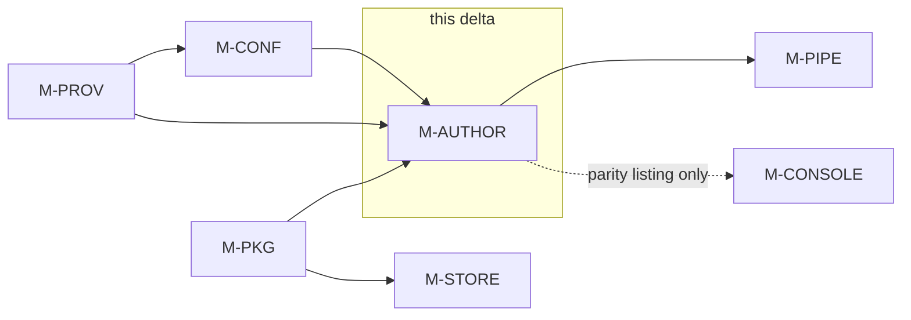

# Detailed Design Delta: Package Authoring from Teacher Documents — `M-AUTHOR`

**Source:**
- The user's directive (2026-10-11): *"Create a detailed design document for a module that
  converts a teacher's test and grading description into structured test packages."* The full
  directive is restated in §1.3; its ten requirement groups are labelled R-1 … R-10 and each is
  discharged by the design elements named against it.
- `docs/design/detailed-design.md` v1.4 (the "base design").
- `docs/design/fix_gaps_detailed_design_plan.md` v1.5.1-delta (the "gap delta").
- `docs/design/jev_decision_engine_design_delta.md` v1.8-delta (the "Jev delta").
- `docs/design/closeout_design_delta.md` v1.9.1-delta (the "close-out delta").
- `docs/design/operator_requirements_design_delta.md` v1.10-delta (the "operator delta"). This
  document applies on top of all five, in that order.
- The shipped spec vocabulary and sample packages: `docs/live-tests/config/eng7-read-01.package.toml`
  and `docs/live-tests/config/ps9-forces-01.package.toml`, read by `aeh package build`
  (`aeh.pipeline.packages`, `aeh.pkg.spec_criteria`).

**Code baseline validated against:** `main` @ `473c23c`.

**Version:** 1.12-delta  **Date:** 2026-10-11  **Status:** Draft, for review before `/create-test-plan`.
**Author:** `/detailed-design-generator`, delta mode.

## Revision history

| Version | Date | Change | Author |
|---|---|---|---|
| 1.12-delta | 2026-10-11 | **Retry and recreate (the directive's second message, same day).** The teacher can always re-run `aeh author draft` — after a failed or unsatisfactory run, or after editing their test or grading description — and the draft regenerates from the documents as they are now. Three requirements added: overwrite protection (an existing not-ready draft is never silently replaced — confirm or `--force`, FR-AUTHOR-22), **answer carry-over** (teacher answers recorded at review are re-applied to a regenerated draft when the item still exists and its content is unchanged, dropped with a named reason otherwise, and provisional until confirmed at review — FR-AUTHOR-23), and the report as the carry-over source of truth (FR-AUTHOR-12 amended; CT-AUTHOR-18…20 added). `--force` on the draft command. Fixture `AF-13` added for the modify-and-recreate flow. ADR-43's consequences extended. | `/detailed-design-generator` (user directive) |
| 1.11-delta | 2026-10-11 | **Package authoring from teacher documents.** <br>• **New `M-AUTHOR`** (`aeh.author`): turns one or more teacher-authored PDFs — a test description and its grading instructions, written for a human colleague — into a draft package spec plus an authoring report, best-effort, with placeholders for anything it could not determine (R-1…R-6). FR-AUTHOR-01…20, NFR-AUTHOR-01…06, CT-AUTHOR-01…17. <br>• **Reasoning chain from the run configuration** (R-2): the profile's ordered judge panel, then escalation judges, first judge first, with fallback down the chain; no new model role and no new config surface. FR-CONF-33, CT-CONF-23, ADR-42. <br>• **Best-effort + placeholders** (R-3): an undetermined field becomes a `# PLACEHOLDER` comment and a sentinel value; a draft containing a sentinel is refused by `aeh package build` until the teacher completes it (FR-PKG-28, CT-PKG-23). <br>• **Human approval** (R-4): `aeh author review` walks the teacher through every unresolved item; review exits *ready* only when zero placeholders remain and every structural check passes. CLI first; console wiring is future work, listed present-and-unavailable (FR-CONSOLE-46). <br>• **CLI registration** (R-4): the `aeh author draft` / `aeh author review` subcommands (FR-PIPE-10). <br>• **Test fixtures and tiers** (R-5, R-6): twelve authored-fixture PDFs (`AF-01`…`AF-12`) covering single- and two-document, happy-path and human-intervention cases, every workflow part; local deterministic replay through `RecordedFixtureProvider` and a live OpenRouter tier keyed by `OPENROUTER_API_KEY` from `.env-dev` (§5). <br>• **New ADRs:** ADR-41 (separate module, not an extension of M-SETUP), ADR-42 (the reasoning chain is the judge panel), ADR-43 (no store persistence — the draft files are the state), ADR-44 (scanned teacher documents ride the profile transcriber). <br>• **No migration.** No store table is added; the Tier migration chains and `COMPLETE_SCHEMA_VERSIONS` are untouched. | `/detailed-design-generator` (user directive) |

---

## 1. Scope & purpose

This is a **delta**, not a replacement. The five prior documents specify the grading engine and
its operator surfaces; this one adds a new front door to the same system: a teacher who can write
a test description the way they would hand it to a colleague — "here is the test, and here is how
I grade it" — gets a draft package out of it, without ever meeting a TOML file.

### 1.1 The one-sentence reading of the directive

A non-technical teacher hands the system the documents they already have; a reasoning model reads
them the way a human colleague would, maps the grading intent onto the rubric shapes the grading
engine supports, and produces a structured package — **never trusted, always reviewed**: whatever
the model could not determine is a named placeholder the teacher must fill, and no draft becomes
a package without a human walking it and approving it.

### 1.2 What changes, what does not

**Changes:** how a package spec comes into existence. Until now the spec was either authored by an
engineer (`docs/live-tests/config/*.package.toml`) or produced by the console's interactive setup
flow (FR-PKG-27: the console publishes from the confirmed setup flow; the spec TOML is a
system-emitted export). This delta adds a third, machine-emitted path: **authoring from teacher
documents**, which produces that same system-emitted spec shape from prose, offline and
best-effort, with a review step in the terminal.

**Stays the same.** Every structural guarantee of the prior documents is either untouched or
*consumed unchanged*, never weakened:

- **The spec vocabulary and the schema lock.** The draft is written in exactly the operator spec
  vocabulary of FR-PKG-27 — `package`, `approved_by`, `[[question]]`, `[[criterion]]` with
  `score_method ∈ {bands, evidence_sum, general}`, `key`, `bands`, `[grades]` — and is consumed
  by the unchanged `aeh package build`, which still enforces every M-PKG rule (§3.1, FR-AUTHOR-10).
- **The rubric-method decision.** Bands are even-numbered 2–6, worst first; an evidence_sum
  composite decomposes into binary aspect criteria; a `general` criterion stores the teacher's
  prose as `derivation_description` provenance that no model re-reads at grading time
  (FR-PKG-24…26, ADR-39). Authoring *produces* these shapes; it does not change them.
- **Judgment isolation and the numeral-free rubric surface** downstream: nothing authoring does
  reaches a judge; the draft is inert until built and published.
- **The single egress point and the recorded transport** (CT-PROV-15, CT-PROV-10): every model
  call authoring makes goes through `M-PROV`; with `HARNESS_FIXTURE_DIR` set the whole workflow
  replays with no network.
- **No teacher-authored TOML** (operator delta R-12) survives intact, because the draft spec is
  *machine-emitted* — and even its completion path does not require the teacher to edit TOML:
  `aeh author review` accepts plain-language answers and writes the file itself (NFR-AUTHOR-05).
- **Console invariants:** the console gains nothing in this delta; the only console-side change is
  a parity-census listing (§3.5), and the authoring screens are explicitly future work.

### 1.3 The directive's requirements, restated and labelled

| # | Requirement (from the directive) | Discharged by |
|---|---|---|
| R-1 | Teachers cannot produce structured packages; they write documents describing the test and how to grade it — one document with both, or a test document plus a separate grading description — as they would hand them to a grading colleague | FR-AUTHOR-01, FR-AUTHOR-06; the two-document case is fixture `AF-02` (§5) |
| R-2 | A reasoning engine reads the PDFs, understands content and intent, and uses **the first judge model from the system runtime configuration**; if it fails, the second, and so on | FR-CONF-33, FR-AUTHOR-04, FR-AUTHOR-05; ADR-42 |
| R-3 | The engine maps the general grading description to the supported rubric types — `evidence_sum`, `bands`, `general` — and identifies multiple-choice questions, turning the human grading strategy into the structured package | FR-AUTHOR-06…08; fixtures `AF-03`/`AF-04`/`AF-05`/`AF-12` |
| R-4 | Incomplete documents or failed reasoning must still yield a package, best-effort, with placeholders the teacher fills and a flag that the package is incomplete | FR-AUTHOR-11 (placeholders), FR-AUTHOR-12 (the report is the flag), FR-PKG-28 (the gate that stops an incomplete draft publishing); fixtures `AF-06`/`AF-07`/`AF-08`/`AF-09`/`AF-11` |
| R-5 | The module must provide and log a clear description of successes and failures so the user understands the state and quality of the generated package | FR-AUTHOR-12 (report), FR-AUTHOR-15 (completion summary), FR-AUTHOR-19 (logging) |
| R-6 | Humans must go over the package and approve it — command line first, console UI later | FR-AUTHOR-16/17 (review walk and gate), FR-PIPE-10 (CLI), FR-CONSOLE-46 (parity listing; console screens future) |
| R-7 | At least 10 different PDF test descriptions: some single-document, some with the grading strategy as a separate document | §5, fixtures `AF-01`…`AF-13` (thirteen) |
| R-8 | Tests demonstrate the happy path (fully generated) and scenarios requiring human intervention, and cover each part of the package-generation workflow | §5 fixture matrix + the coverage map |
| R-9 | Testing runs locally **and** against a real OpenRouter endpoint with real LLM models | §5 tiers: recorded deterministic replay (`CT-PROV-10`) and the `live` marker tier |
| R-10 | Use the OpenRouter API key provided in `.env-dev` | §5 live tier: `OPENROUTER_API_KEY` (the key `.env-dev` carries) exported into the environment, exactly as the existing live tests require it |
| R-11 | *(Directive, second message, 2026-10-11.)* The teacher must **always** be able to retry and recreate the package — when something went wrong, and when they modified their test or grading description | FR-AUTHOR-21 (re-draft is always the retry), FR-AUTHOR-22 (never a silent overwrite), FR-AUTHOR-23 (answer carry-over so an edit doesn't discard review work); fixture `AF-13` |

### 1.4 Conventions

- **IDs** continue from the highest ID in use across the five prior documents, `src/` and `tests/`
  at `473c23c`. They are append-only. First new IDs per module:

  | Module | First new FR | First new NFR | First new CT |
  |---|---|---|---|
  | **M-AUTHOR (new)** | FR-AUTHOR-01 | NFR-AUTHOR-01 | CT-AUTHOR-01 |
  | M-CONF | FR-CONF-33 | — | CT-CONF-23 |
  | M-PIPE | FR-PIPE-10 | — | — |
  | M-PKG | FR-PKG-28 | — | CT-PKG-23 |
  | M-CONSOLE | FR-CONSOLE-46 | — | — |
  | ADRs | ADR-41 | | |

- **Migrations.** None. M-AUTHOR writes no store row (ADR-43); the Tier migration chains,
  `COMPLETE_SCHEMA_VERSIONS`, and the CLAUDE.md migration-chain paragraph are untouched.
- **Knobs** are named `HARNESS_*`, take the production value as default, and refuse invalid
  values (seam 3). The reasoning chain is deliberately **not** a knob: which models may reason
  comes from the run configuration, and a per-module override would bypass the pinned-build and
  zero-retention discipline (ADR-42).
- `Assumption:` marks any number or choice the prior documents do not supply.

---

## 2. Module inventory (delta)

| Module ID | Name | Change | Depends on (delta) |
|---|---|---|---|
| **M-AUTHOR** | **Package Authoring (new)** | Turns one or more teacher-authored PDFs into a draft package spec and an authoring report: extract text, reason over it with the profile's judge models in order, map the grading intent onto the supported rubric shapes, fill what it can, placeholder what it cannot, and hand the result to a human review walk. Owns nothing published. | `M-CONF` (the reasoning chain), `M-PROV` (every model call), `M-PKG` (the spec vocabulary and the structural rules a draft must satisfy) |
| M-CONF | Deployment Profile & Run Configuration | Adds `panel_for_profile` — the profile's ordered judge refs for authoring, without a cohort or a run (R-2). | unchanged |
| M-PIPE | Pipeline CLI & Composition | Registers the `aeh author draft` / `aeh author review` subcommands (R-4, R-6). | unchanged, plus M-AUTHOR |
| M-PKG | Assessment Package Catalog | `aeh package build` refuses a spec carrying a placeholder sentinel (R-4). One clause added. | unchanged |
| M-CONSOLE | Console API Server | The parity census lists the `author` commands present-and-unavailable (R-6). | unchanged |

Everything else — M-INGEST, M-SETUP, M-JUDGE, M-AGG, M-REVIEW, M-GRADE, M-STATS, M-STORE, M-UI,
M-HELP — is unchanged by this delta.

---

## 3. Per-module detailed design

### 3.1 Module: Package Authoring (`M-AUTHOR`)

**Responsibility**: Turn teacher-authored PDF documents — a test description and its grading
instructions, written for a human colleague — into a **draft package spec** in the operator
vocabulary plus an **authoring report** that states exactly what was resolved, by which model,
and what the teacher must still supply; then walk the teacher through a review that completes the
draft. It explicitly does **not** own: publishing (that is `aeh package build`, M-PIPE/M-PKG, and
only after review), the interactive step-by-step setup flow (M-SETUP, whose blocking gates this
module deliberately replaces with one end-review — ADR-41), any console screen (M-UI — future
work), student submissions (M-INGEST), and any store state (ADR-43).

**The workflow in one paragraph.** The teacher runs
`aeh author draft --config <config.toml> --docs <pdf...> --out <dir>` (the backend profile is
resolved from the config the way `aeh run` resolves it — `HARNESS_PROFILE` in the file, the
terminal wins). The module extracts each
document's text (text layer first; scanned pages ride the profile transcriber). Then, per step —
question inventory, per-question rubric mapping, grade boundaries — it asks the reasoning chain:
the profile's first judge model; on failure or an unusable reply, the next judge; then escalation
judges. Every model proposal must pass the same deterministic structural rules `aeh package build`
enforces before it enters the draft; a proposal that cannot be made to pass is left **unresolved**
and becomes a named placeholder. The module writes `<package>.package.draft.toml` and
`<package>.authoring-report.md`, and prints the state of the draft. The teacher then runs
`aeh author review --draft <file>`, which walks every unresolved item in plain language, accepts
answers, updates the draft, and re-validates; review exits *ready* only when nothing is left to
fill. The teacher builds the package with the existing `aeh package build --spec …` — which
refuses any draft that still carries a placeholder. **Re-running the draft command is always the
retry and the recreate** (FR-AUTHOR-21): after a failed run, after a fix, or after the teacher
edits their test or grading description, the same command regenerates the draft from the documents
as they are now — confirming before it overwrites a draft the teacher has worked on (FR-AUTHOR-22)
and carrying over the review answers whose questions did not change (FR-AUTHOR-23).

**Functional requirements**

| ID | Requirement | Notes |
|----|-------------|-------|
| FR-AUTHOR-01 | The module shall accept one or more PDF document paths, a profile configuration path, and an output directory, and shall produce a draft spec TOML and an authoring report in that directory, returning a `DraftResult`; the full workflow shall run headless from code and shall complete with no network when the provider is `RecordedFixtureProvider`. | Seam 1 and seam 2; `CT-CONSOLE-01`'s headless rule applied to the new module |
| FR-AUTHOR-02 | The module shall extract each PDF's text layer with `pypdf`; for a page with no text layer it shall transcribe that page through the profile's transcriber model via `M-PROV` when `HARNESS_AUTHOR_TRANSCRIBE=auto` (the default), and shall fail with `AuthoringInputError` naming the page when the knob is `off`. | ADR-44; transcriber build comes from the profile's `[profiles.<p>.transcriber]` |
| FR-AUTHOR-03 | The module shall make every model call — reasoning steps and transcriptions alike — through an `M-PROV` `InferenceProvider`, and shall import no HTTP client of its own; the request payload shall carry only the extracted document text and the step prompt. | CT-PROV-15 is the egress point; the module never sees a key |
| FR-AUTHOR-04 | The module shall build its reasoning chain from the run configuration, in this order: the profile's `[[panel]]` judge refs in their declared order, then the profile's `[[escalation_judge]]` refs in their declared order, de-duplicated by build identity; the first judge model answers first, and an empty chain is a `ConfigurationError` raised before any model call. | R-2, "first judge model … then the second, and so on"; ADR-42 |
| FR-AUTHOR-05 | The module shall fall back to the next model in the chain for a reasoning step when (a) the call fails with a provider error after `M-PROV`'s own retries, (b) the reply is unparseable after `HARNESS_AUTHOR_ATTEMPTS` repair attempts against the same model, or (c) the proposal fails the deterministic structural validation after the same repair budget; when every model in the chain is exhausted for an item, the item is recorded **unresolved** and the run continues. | R-2 fallback; the repair attempt is the same prompt plus the validator's rejection reason |
| FR-AUTHOR-06 | The module shall propose the question inventory from the document text, in paper order: `id`, `type` (`mcq` or `open`), `points`, `text`, `options` (for mcq), and `model_answer`; any field it cannot determine becomes a placeholder. | R-1, R-3; the step is one call per document set, not per question |
| FR-AUTHOR-07 | The module shall map each question's grading description onto exactly one of the supported rubric shapes: an mcq **answer key** (a `key` drawn from that question's declared options), an **evidence_sum** composite with binary aspect criteria (`component_of`, two-band absent/present aspects), a **bands** set (an even number 2–6, worst first, non-decreasing points), or a **general** criterion — the teacher's prose kept verbatim in `derivation_description` with bands derived from it. The module shall choose no shape the grading engine does not support. | R-3; the shapes are FR-PKG-24/26's; a general line stores and grades exactly as a bands line |
| FR-AUTHOR-08 | The module shall derive the `[grades]` boundary table from the grading description's stated boundaries, and shall emit a placeholder for the whole `[grades]` table when the documents state no boundary — it shall never invent a grade boundary. | R-3, R-4; fixture `AF-11` |
| FR-AUTHOR-09 | The module shall emit `approved_by` as a placeholder, filled by the teacher at review — it shall never be model-generated, since it names the human who approved the questions and rubric. | The package records that name on the published version |
| FR-AUTHOR-10 | The module shall validate every model proposal against the same deterministic structural rules `aeh package build` enforces (band count parity and bounds, monotone points, key ∈ options, every question covered by at least one line, evidence_sum composite shape) before writing it into the draft, and shall never write a proposal that failed validation. | The reasoning model proposes; only the deterministic checks accept. In code, `plan_package` (the build's pure pre-check, `pipeline/packages.py`) owns the structural rules, while band-count parity, monotone points and contiguity are enforced later, at build time, by `pkg.criteria` — so `validate_draft` wraps both layers, and the differential-vs-build case keeps them from drifting |
| FR-AUTHOR-11 | The module shall emit a placeholder for every field it could not determine: a `# PLACEHOLDER(<reason>): <what the teacher must supply>` comment on the line above, and the sentinel value `<<PLACEHOLDER: <field>>>` as the field's value; it shall never fill an undetermined field silently, and a draft containing any sentinel shall never be accepted by `aeh package build` (FR-PKG-28). | R-4; the sentinel is the incompleteness flag the teacher sees |
| FR-AUTHOR-12 | The module shall write an authoring report at `<package>.authoring-report.md` with, in order: the **Documents** section (each document, its page count, how its text was obtained), the **Steps** section (per step and per item: outcome, which model produced it, attempt count, and the failure reasons in fallback order), the **Items** section (per question: resolved / placeholder / unresolved; and for every item the teacher answered at review, the answer and the content fingerprint it was given against — the carry-over source of truth, FR-AUTHOR-23), the **Unresolved** list in review order, and the **Next command** line; the report shall be written even when every reasoning step failed, provided at least one document's text was extracted. | R-5; this report is the teacher-facing description of state and quality |
| FR-AUTHOR-13 | The module shall raise `AuthoringInputError`, before any model call and without writing any artifact, when no document is readable, or when no text can be extracted from any document while `HARNESS_AUTHOR_TRANSCRIBE=off` — and the error shall name the failing document. (A profile that names no judge model is a different failure: `ConfigurationError` from `M-CONF`, per FR-CONF-33, also before any call.) | Fail fast on inputs no reasoning can recover |
| FR-AUTHOR-14 | The module shall write exactly two artifacts — the draft spec and the report — into the caller's output directory, shall not write to any store, catalog, or published package, and shall never mint or publish a package version. | ADR-43 |
| FR-AUTHOR-15 | The module shall be deterministic under identical inputs and identical recordings: a re-run with the same documents, configuration, and fixture recordings shall produce byte-identical draft and report, and shall overwrite only its own two artifacts. | Recorded-replay repeatability; the report records models used, which recordings pin |
| FR-AUTHOR-16 | The `aeh author review` command shall walk the teacher through every unresolved item and placeholder in the report's order, one at a time, accept a plain-language answer for each (displaying the current value and the reason it is missing), rewrite the draft in place, re-run the deterministic validation on the updated draft, and rewrite the report. | R-6; NFR-AUTHOR-05 governs the walk's wording |
| FR-AUTHOR-17 | `aeh author review` shall exit *ready* — and say so, with the build command — only when the draft contains zero placeholders and every structural check passes; otherwise it shall list the items that remain, update what it could, and exit non-zero. | R-4's human gate; the non-zero exit is what a scripted caller tests |
| FR-AUTHOR-18 | On draft completion the module shall print a one-paragraph summary: how many items resolved, how many are placeholders, which models were used, and the exact next commands (`aeh author review …`, then `aeh package build …`). | R-5 |
| FR-AUTHOR-19 | The module shall log to the logger named `aeh.author`: INFO for each step's outcome, WARNING for every fallback and every placeholder, DEBUG for failure detail; it shall never log a credential, a page image, or a full document text at any level. | R-5; NFR-AUTHOR-04 |
| FR-AUTHOR-20 | The module shall pin its prompts as versioned constants (`AUTHOR_INVENTORY_TEMPLATE_V`, `AUTHOR_RUBRIC_TEMPLATE_V`, `AUTHOR_GRADES_TEMPLATE_V`), carried into every request, so a prompt change cannot silently replay stale recordings. | The same discipline as `SETUP_*_TEMPLATE_V`; a prompt bump invalidates the affected fixtures' recordings on purpose |
| FR-AUTHOR-21 | The module shall permit `draft()` to be re-run at any time, and shall always regenerate the draft from the documents as they are at invocation — after a failed or unsatisfactory run, after a fix, and after the teacher has edited their test or grading description. Re-running the draft command is the retry and the recreate; no state outside the module's two artifacts is needed to retry. | R-11; the regeneration loop is FR-AUTHOR-15's determinism read in the retry direction |
| FR-AUTHOR-22 | When the output directory already holds a draft and report for the same package id, `aeh author draft` shall refuse to overwrite them until the teacher confirms — interactively, or with `--force` — and the refusal shall name what would be replaced and that recorded review answers may carry over (FR-AUTHOR-23); without confirmation nothing is written. | R-11's "always able" must not mean "always silently destructive": a half-reviewed draft holds the teacher's work |
| FR-AUTHOR-23 | When a prior report for the same package id exists, the module shall re-apply each teacher answer recorded in it to the regenerated draft, iff the item still exists and the content fingerprint recorded with the answer matches the regenerated item's content; an answer whose item changed or vanished shall be dropped, and the new report shall name every dropped answer and the reason. A carried-over answer is provisional until the teacher confirms it at review — carry-over fills the draft, it never satisfies the human gate by itself. | R-11; the fingerprint is the hash over the item's id and underlying content (for a question: id + text) recorded at answer time |

**Interfaces**

Python surface (all synchronous; the module is a library first, CLI second):

```python
class AuthoringService:
    def __init__(self, chain: Sequence[ModelRef], provider: InferenceProvider,
                 transcriber: ModelRef | None, settings: AuthoringSettings) -> None: ...
    def draft(self, documents: Sequence[Path], output_dir: Path) -> DraftResult: ...
    def review(self, draft_path: Path, answers: Iterable[ReviewAnswer] | None = None) -> ReviewResult: ...

def validate_draft(spec: Mapping[str, Any]) -> list[DraftIssue]:
    """The deterministic checks, pure, usable on any spec — also what review re-runs."""
```

`review(answers=None)` runs the interactive terminal walk; `review(answers=[...])` is the
scripted form the tests use, so the walk's logic is testable without a tty.

CLI surface (registered by M-PIPE, FR-PIPE-10):

| Command | Arguments | Behaviour | Errors |
|---|---|---|---|
| `aeh author draft` | `--config <config.toml>`, `--docs <pdf>…`, `--out <dir>`, optional `--force` | Runs the workflow; over an existing draft and report for the same package id, asks for confirmation unless `--force` (FR-AUTHOR-22), then carries over the prior report's still-valid answers (FR-AUTHOR-23); prints FR-AUTHOR-18's summary | `AuthoringInputError` (exit 1, nothing written); provider exhaustion is *not* an error — it produces placeholders; an unconfirmed overwrite (exit 1, nothing written) |
| `aeh author review` | `--draft <file>` | The review walk; `ready` prints the build command | exit 0 when ready; exit 1 while items remain, and exit 1 with the reason when the draft file is missing or not an authoring draft — §3.1's exit convention, below |

Exits use M-PIPE's existing convention — `main(argv) -> int` returns `0` on completion and `1`
(`EXIT_ERROR`) on any error, and no new exit code is introduced: an input error, an unconfirmed
overwrite, a review with items remaining, and a review of a missing or non-authoring file all
exit 1, distinguished by their output rather than by a code. Exit 2 remains argparse's
usage-error code alone, exactly as the rest of the CLI behaves today.

Callers: `M-PIPE` (the CLI), tests; downstream consumer of the *artifact*: `aeh package build`.
Called: `M-CONF` (chain), `M-PROV` (every call), `M-PKG`'s rules (via `validate_draft`).

**Data structures & data model**

```python
StepId = Literal["inventory", "rubric", "grades"]          # the reasoning steps, in run order
ItemStatus = Literal["resolved", "derived", "placeholder", "unresolved"]

@dataclass(frozen=True)
class StepOutcome:
    step: StepId; item_id: str; status: ItemStatus
    model: str | None          # the build id that produced the accepted proposal
    attempts: int              # repair attempts spent on the winning model
    failures: tuple[str, ...]  # one reason per rejected model, in fallback order

@dataclass(frozen=True)
class DraftResult:
    draft_path: Path; report_path: Path
    outcomes: tuple[StepOutcome, ...]
    placeholders: int; resolved: int; unresolved: int
    models_used: tuple[str, ...]      # in first-use order — a subset of the chain

@dataclass(frozen=True)
class ReviewAnswer:      # the scripted form of one terminal answer
    item_id: str; value: str

@dataclass(frozen=True)
class ReviewResult:
    ready: bool; remaining: tuple[str, ...]   # item ids still placeholder/unresolved

@dataclass(frozen=True)
class DraftIssue:        # one deterministic-validation finding
    field: str; message: str   # e.g. "C2.bands", "band count 5 is odd — must be even, 2 to 6"
```

State model — the draft artifact's lifecycle (files only; ADR-43):

```
  drafted ──(review mutates in place, re-validating)──▶ ready ──(aeh package build)──▶ published
     ▲                                                    │
     └────────────── (re-run regenerates) ────────────────┘  ready means: zero placeholders,
                                                             all checks pass (FR-AUTHOR-17)
```

There is no fourth state and no stored state: "ready" is a property the report states and
`validate_draft` re-proves, not a flag anyone sets.

The placeholder sentinel: value `<<PLACEHOLDER: <field>>>` with the reason comment above. The
sentinel string is deliberately outside every legal value of every field it can occupy (a question
text, a key letter, a points number, a grade boundary), which is what makes FR-PKG-28's refusal a
one-line check.

**Data flow**

```mermaid
sequenceDiagram
    participant T as Teacher (terminal)
    participant A as M-AUTHOR
    participant P as M-PROV (chain: judge 1 → judge 2 → …)
    participant B as M-PIPE / M-PKG (the build)

    T->>A: aeh author draft --config cfg --docs *.pdf --out dir
    A->>A: extract text layer (pypdf)
    opt scanned page, HARNESS_AUTHOR_TRANSCRIBE=auto (FR-AUTHOR-02)
        A->>P: page image → profile transcriber build
        P-->>A: page text
    end
    alt no readable text anywhere, or transcribe off (FR-AUTHOR-13)
        A--xT: AuthoringInputError naming the document — nothing written, exit 1
    end
    loop per step: inventory → rubric → grades
        loop per model in the chain, until one passes (FR-AUTHOR-04, FR-AUTHOR-05)
            A->>P: step prompt (versioned template)
            P-->>A: reply — or retryable/unavailable/malformed → A moves to the next model
            A->>A: validate_draft: the deterministic, model-independent rules (FR-AUTHOR-10)
            opt validator rejects
                A->>A: repair attempt (≤ HARNESS_AUTHOR_ATTEMPTS) on the same model
            end
        end
        A->>A: record the StepOutcome (winning model, attempts, failure reasons in order)
    end
    A->>T: draft + report written; summary (FR-AUTHOR-18): resolved / placeholders / models used
    T->>A: aeh author review --draft file
    loop each placeholder or unresolved item, in report order (FR-AUTHOR-16)
        A->>T: show the current value and why it is missing
        T-->>A: plain-language answer
        A->>A: rewrite the draft in place; re-validate
    end
    A->>A: rewrite the report
    alt ready (zero placeholders, all checks pass — FR-AUTHOR-17)
        A->>T: print the build command
        T->>B: aeh package build --spec draft
        B-->>T: published version id — or refusal naming file, field, reason (FR-PKG-28, CT-PKG-23)
    else items remain
        A->>T: list what remains; exit 1
    end
```

**Dependencies**

| Depends on | Direction | Nature | Why |
|---|---|---|---|
| `M-CONF` | upstream | library | `panel_for_profile` (FR-CONF-33) yields the ordered chain; `ModelRef` and `ConfigurationError` are M-CONF's types |
| `M-PROV` | upstream | library | `InferenceProvider` for every model call; provider resolution rides the pipeline's profile mapping (`pipeline.runtime`'s `_provider_for`): `HARNESS_FIXTURE_DIR` set → `RecordedFixtureProvider`, else the live provider — not bare `provider_for`, which maps only live transports; retry policy rides here |
| `M-PKG` | upstream | library | the spec vocabulary (FR-PKG-27's export shape) and the structural rules `validate_draft` re-uses |
| `M-PIPE` | downstream | sync call | the CLI registers and calls this module (FR-PIPE-10) |
| `M-CONSOLE` | downstream | listing only | the parity census names the commands (FR-CONSOLE-46); no runtime dependency |
| `pypdf` | upstream | library | the text-layer extraction (already a `[project]` dependency, operator delta R-1) |

Deliberately **not** a dependency: `M-INGEST` (its validation ladder is submission-specific;
teacher documents are not submissions — ADR-44), `M-SETUP` (different bounded context — ADR-41).

**Non-functional requirements**

| ID | Category (ISO 25010) | Requirement |
|----|----------------------|-------------|
| NFR-AUTHOR-01 | Reliability | Best-effort continuation: one step's total failure — every model in the chain exhausted — never aborts the draft; the partial result and the report survive, and the affected items are placeholders |
| NFR-AUTHOR-02 | Performance efficiency | For a 10-question test on the dev-ci panel: at most `HARNESS_AUTHOR_ATTEMPTS × |chain|` `complete()` calls per item — authoring-level calls; `M-PROV`'s internal retry budget sits underneath and is not part of this ceiling — ≈ ≤ 30 calls end to end; p95 wall-clock under 10 minutes on OpenRouter. *Assumption: a reasoning step on a frontier-class judge is seconds, not minutes; confirm on the first live run.* |
| NFR-AUTHOR-03 | Portability | The full workflow runs headless, with `HARNESS_FIXTURE_DIR` set, with the cable unplugged (seams 1–2); no console and no network required |
| NFR-AUTHOR-04 | Security | No credential, page image, or wholesale document text in any log, report, or error message; teacher text leaves the machine only through `M-PROV`, which carries the zero-retention request flags on `dev-ci` |
| NFR-AUTHOR-05 | Usability | The review walk speaks plain language — one item at a time, the missing value's reason shown, the teacher's answer accepted in prose; completing a draft never requires editing TOML by hand |
| NFR-AUTHOR-06 | Maintainability | Each reasoning step is its own module file with its own prompt constant and validator; adding a rubric shape touches one step file and its fixture, not the service |

**Performance requirements**

- End-to-end wall clock: p95 < 10 min for a 10-question test on a hosted panel (`Assumption:` two
  reasoning calls per question class plus one inventory call; verify on the first live run and
  re-pin `HARNESS_AUTHOR_TIMEOUT_S` if the assumption fails).
- Recorded replay: the full fixture set (§5) drafts in < 5 s — the fast tier's budget.
- Call budget: bounded by construction — `steps × items × HARNESS_AUTHOR_ATTEMPTS × |chain|`;
  there is no unbounded retry anywhere in the module.

**Security requirements**

- **Egress:** every model call rides `M-PROV` (CT-PROV-15). The module never reads
  `OPENROUTER_API_KEY`; the provider does.
- **Data classification:** teacher-authored test descriptions. No student work and no student
  identity enters an authoring request — the module sends only document text and prompt text
  (FR-AUTHOR-03), so no consent gate is required (contrast the run path's cohort consent).
  On `dev-ci` the request still carries the zero-retention flags the live provider sets.
- **Secrets:** `.env-dev`'s key reaches the provider only through the environment
  (`OPENROUTER_API_KEY`); it never appears in a report, log, draft, or error (FR-AUTHOR-19,
  NFR-AUTHOR-04).
- **Input handling:** document text is data, never instructions — the step prompts wrap the
  extracted text so that instructions inside a teacher document cannot rewrite the step's
  contract with the model (the validator would reject the resulting malformed proposal anyway,
  and the placeholder path absorbs it).
- **STRIDE, briefly:** T (tampering) — the model's output is never trusted past the deterministic
  validator (FR-AUTHOR-10); I (disclosure) — NFR-AUTHOR-04; R (repudiation) — `approved_by` is
  never model-generated (FR-AUTHOR-09); E — none, the module holds no privilege.

**Error handling & resilience**

| Failure | Handling |
|---|---|
| PDF unreadable / zero text anywhere, transcribe `off` | `AuthoringInputError` before any call; nothing written (FR-AUTHOR-13) |
| Page without a text layer | Transcriber call via `M-PROV` (knob-gated); a failed transcription leaves that document's pages missing from the step prompts and is recorded in the report's Documents section |
| Provider error after `M-PROV`'s retries | Next model in the chain (FR-AUTHOR-05a) |
| Unparseable reply | Up to `HARNESS_AUTHOR_ATTEMPTS` repair attempts on the same model — the repair reply carries the parser's complaint — then next model (FR-AUTHOR-05b) |
| Proposal fails the structural validator | Same repair budget with the validator's issues in the repair prompt, then next model; still failing → unresolved item → placeholder (FR-AUTHOR-05c, FR-AUTHOR-11) |
| Every model exhausted for an item | Item unresolved; run continues (NFR-AUTHOR-01); report lists it first |
| Chain empty / profile malformed | `ConfigurationError` from M-CONF before any call (FR-AUTHOR-04) |
| Review on a missing/non-draft file | exit 1 with the reason (§3.1 CLI table and exit convention) |

There is no circuit breaker and no queueing: the workflow is one teacher, in attendance, once.

**Observability**

- Logger `aeh.author`: INFO per step outcome, WARNING per fallback/placeholder, DEBUG for failure
  detail (FR-AUTHOR-19). Log lines name the step and item ids, so a support question — "why is Q4
  empty?" — is answerable from the log alone.
- The report is the user-facing trace: per-item outcome, model, attempts, failure reasons, in
  order (FR-AUTHOR-12) — seam 4's per-stage observability, next to the status rather than behind
  it.
- What would "page someone": nothing. This is an attended, teacher-facing workflow; the teacher
  is the on-call.

**Configuration**

| Knob | Default | Effect | Refuses |
|---|---|---|---|
| `HARNESS_AUTHOR_ATTEMPTS` | `2` | Repair attempts per item per model (FR-AUTHOR-05b/c) | < 1 or > 5 |
| `HARNESS_AUTHOR_TIMEOUT_S` | `240` | Per-call timeout passed to the provider plan | < 30 |
| `HARNESS_AUTHOR_TRANSCRIBE` | `auto` | `auto`: no-text-layer pages ride the profile transcriber; `off`: refuse (FR-AUTHOR-02) | any other value |

The reasoning chain is **not** configurable here — it is the run configuration's panel and
escalation judges (FR-AUTHOR-04, ADR-42). All three knobs are per-invocation; nothing about them
is frozen into a run, because authoring freezes nothing (ADR-43).

**Contract** (`CT-AUTHOR`, v1.0) · Stability: provisional

A caller holding `M-AUTHOR` holds: given teacher documents, a draft spec plus a report that state
exactly what is known and what the teacher must still supply — and a review walk that completes
them. It holds nothing published, no store state, and no model call outside `M-PROV`.

| ID | Kind | Clause (assertable) | Consumers |
|----|------|---------------------|-----------|
| CT-AUTHOR-01 | surface | `AuthoringService.draft(documents, output_dir) -> DraftResult` and `AuthoringService.review(draft_path, answers=None) -> ReviewResult` are synchronous and complete without a network when the injected provider is `RecordedFixtureProvider`. | `M-PIPE`, tests |
| CT-AUTHOR-02 | surface | The CLI subcommands `aeh author draft` and `aeh author review` exist with the flags listed in §3.1, registered by `M-PIPE`. | `M-PIPE`, `M-CONSOLE` |
| CT-AUTHOR-03 | data | `DraftResult` carries exactly `draft_path`, `report_path`, `outcomes`, `placeholders`, `resolved`, `unresolved`, `models_used`; each `StepOutcome` carries exactly `step`, `item_id`, `status`, `model`, `attempts`, `failures`; `status ∈ {resolved, derived, placeholder, unresolved}`; `failures` is ordered by fallback attempt. | `M-PIPE`, tests |
| CT-AUTHOR-04 | data | The draft file uses only the operator spec vocabulary (FR-PKG-27) plus placeholder comments and the sentinel value `<<PLACEHOLDER: <field>>>`; every sentinel line carries a `# PLACEHOLDER(<reason>):` comment naming what the teacher must supply. | `M-PIPE`, `M-PKG` |
| CT-AUTHOR-05 | data | The report file is `<package>.authoring-report.md` beside the draft `<package>.package.draft.toml`, both named after the package id the documents state, with the sections Documents, Steps, Items, Unresolved, Next command, in that order. | `M-PIPE`, tests |
| CT-AUTHOR-06 | behaviour | Model fallback order is the chain order of FR-AUTHOR-04 — profile panel then escalation judges, de-duplicated — and the first model whose reply passes the deterministic validator wins the item. | tests |
| CT-AUTHOR-07 | behaviour | Identical inputs and identical recordings produce byte-identical draft and report; a re-run overwrites only its own two artifacts (the confirmation precondition for overwriting an existing draft is CT-AUTHOR-18). | tests |
| CT-AUTHOR-08 | behaviour | No model proposal enters the draft without passing `validate_draft`'s structural rules — the same rules `aeh package build` enforces; the validator is deterministic and model-independent. | `M-PKG`, `M-PIPE`, tests |
| CT-AUTHOR-09 | error | `AuthoringInputError` is raised only under FR-AUTHOR-13's conditions, before any model call, with no artifact written, and names the failing document; `ConfigurationError` (an empty panel, from `M-CONF`) likewise precedes any call. | `M-PIPE`, tests |
| CT-AUTHOR-10 | error | Once at least one document yields text, `draft()` does not raise: every downstream failure resolves to an unresolved item and a placeholder, and the returned `DraftResult` is populated. | `M-PIPE`, tests |
| CT-AUTHOR-11 | state | `draft()` writes exactly two files into the given output directory — the draft and the report — and no store, catalog, or published version anywhere. | `M-PIPE`, `M-PKG` |
| CT-AUTHOR-12 | state | `review()` mutates only the draft file it was given and rewrites only its report. | `M-PIPE` |
| CT-AUTHOR-13 | perf | A 10-question test drafts in ≤ `steps × items × HARNESS_AUTHOR_ATTEMPTS × |chain|` `complete()` calls (bounded by construction; the ceiling counts authoring-level calls — `M-PROV`'s own retry budget sits underneath), p95 < 10 min on a hosted panel (*Assumption*, NFR-AUTHOR-02), and the recorded fixture set replays in < 5 s. | tests |
| CT-AUTHOR-14 | config | The three knobs of §3.1 exist with those defaults, are read per invocation, and refuse invalid values; no other environment variable changes authoring behaviour, and the chain is not overridable from the module. | tests |
| CT-AUTHOR-15 | observe | The logger is named `aeh.author`, log lines carry step and item ids, and the report is the complete user-facing trace of what each step did — a question answered from the log alone is answerable. | `M-PIPE` |
| CT-AUTHOR-16 | security | No credential, page image, or wholesale document text appears in any log line, report, draft, or exception message; document text reaches a model only inside a step request through `M-PROV`. | all callers |
| CT-AUTHOR-17 | behaviour | **Not promised:** band names, band counts, descriptor wording, and the inventory's question ids beyond paper order are model-produced and may vary between runs and models; nothing outside CT-AUTHOR-03…05's field sets and CT-AUTHOR-08's rules is promised stable. | all callers |
| CT-AUTHOR-18 | error | `draft()` invoked where the output directory already holds a draft and report for the same package id writes nothing until the caller confirms — the interactive prompt or `--force` — and the refusal names what would be replaced; with confirmation, the run proceeds and may carry over the prior report's still-valid answers (CT-AUTHOR-19). | `M-PIPE`, tests |
| CT-AUTHOR-19 | behaviour | A teacher answer recorded in a prior report is re-applied to a regenerated draft iff the item still exists and the fingerprint recorded with the answer matches the regenerated item's content; every dropped answer is named in the new report with its reason; no carried-over answer is final until the teacher confirms it at review (FR-AUTHOR-23). | `M-PIPE`, tests |
| CT-AUTHOR-20 | data | The report's Items section records, for every item the teacher answered at review, the answer and the fingerprint of the content it was given against; a report without those records carries nothing into a later re-draft. | tests |

*Requires*

| Depends on | Clauses relied on | What this module assumes |
|---|---|---|
| `M-CONF` | CT-CONF-23 (new), CT-CONF-03 | `panel_for_profile` returns the profile's ordered, resolved judge refs without a cohort; an empty panel raises rather than returning `()` |
| `M-PROV` | CT-PROV-10, CT-PROV-15 | Recorded replay is exact (a changed prompt misses, never silently answers); every call's retries and retention flags are the provider's, applied once |
| `M-PKG` | CT-PKG-23 (new) | The spec vocabulary is the FR-PKG-27 export shape and is stable enough for the draft to be consumed by the unchanged build command; the build refuses any sentinel |

*Compatibility.* Additive: new steps, new optional `StepOutcome` fields, new rubric-shape handling
inside FR-AUTHOR-07's enumeration, tightened performance bounds. Breaking: any `DraftResult`/
`StepOutcome` field change (CT-AUTHOR-03), a sentinel-format change (CT-AUTHOR-04), report section
changes (CT-AUTHOR-05), chain-order semantics (CT-AUTHOR-06), or any weakening of CT-AUTHOR-08 —
a breaking change bumps `CT-AUTHOR` to v2.0 and re-verifies `M-PIPE` and `M-PKG`. The canonical
test double is `RecordedFixtureProvider` with the authoring recordings under `HARNESS_FIXTURE_DIR`;
a fixture set that does not reproduce the fallback path (a failing head-of-chain reply) and the
placeholder path (an unresolved item) does not honour this contract, and every integration test
built on it would be a lie.

**Open questions / assumptions**

- *Assumption:* NFR-AUTHOR-02's 10-minute p95 — not from the directive; verify on the first live run.
- The draft derives no criterion dependencies (the setup flow's teacher-approved edges): authoring
  emits none, and dependency proposals remain M-SETUP/M-CALIB work. A grading description that
  *implies* a dependency ("Q4 earns nothing unless Q3's reasoning appears") is recorded as an
  unresolved note, not an edge. Revisit if live runs show this is common.
- Cost ceiling: authoring calls are few, and M-PROV's ceiling is run-scoped; this delta relies on
  the bounded call budget instead. If a school wants a hard spend cap on authoring too, that is an
  M-PROV amendment, not an M-AUTHOR one.
- Console authoring screens (upload documents, render the report, review in the browser) are
  future work by the directive's own phrasing ("First, we do it in the command line, but then we
  will connect the entire workflow to the User Interface"); FR-CONSOLE-46 keeps the parity census
  honest until they arrive.

### 3.2 Module: Deployment Profile & Run Configuration (`M-CONF`) — amendment

**Change**: one new entry point so M-AUTHOR can read the reasoning chain the way the directive
names it — the run configuration's judge models — without fabricating a cohort or a run row.

| ID | Requirement | Notes |
|----|-------------|-------|
| FR-CONF-33 | `M-CONF` shall provide `panel_for_profile(cfg, backend_profile) -> tuple[ModelRef, …]`: the named profile's `[[panel]]` judge refs in declared order followed by its `[[escalation_judge]]` refs in declared order, de-duplicated by build identity, each resolved per CT-CONF-03; it shall raise `ConfigurationError` when the profile exists but names no judge model, and shall require no cohort, no consent gate, and no run row. | The consent gate stays run-scoped: authoring sends teacher text, never student data (§3.1 Security) |

**Contract amendment** (`CT-CONF`, v2.3 — one clause added to v2.2):

| ID | Kind | Clause (assertable) | Consumers |
|----|------|---------------------|-----------|
| CT-CONF-23 | surface | `panel_for_profile(cfg, backend_profile)` is synchronous and pure in `cfg`, returns the ordered panel-then-escalation judge refs de-duplicated by build identity, raises `ConfigurationError` on an empty panel, and touches neither the environment (beyond what `ModelRef` resolution already reads) nor any store. | `M-AUTHOR` |

### 3.3 Module: Pipeline CLI & Composition (`M-PIPE`) — amendment

| ID | Requirement | Notes |
|----|-------------|-------|
| FR-PIPE-10 | The CLI shall register the `aeh author` subcommand group with `draft` and `review` wired to `M-AUTHOR` per §3.1's table, shall exit 1 (`EXIT_ERROR`) on `AuthoringInputError` with nothing written and exit 1 from `review` while items remain, per §3.1's exit convention; the `draft` help shall state that the package publishes only through `aeh package build` after review. | R-4, R-6 |

### 3.4 Module: Assessment Package Catalog (`M-PKG`) — amendment

| ID | Requirement | Notes |
|----|-------------|-------|
| FR-PKG-28 | `aeh package build` shall refuse a spec whose text contains the placeholder sentinel `<<PLACEHOLDER:` — naming the file, the field, and the placeholder reason — before any other check; a draft that is not complete shall not build, however well-formed the rest of it is. | R-4's enforcement half; the structural checks already catch missing fields, but not a well-formed file carrying sentinel values |

**Contract amendment** (`CT-PKG`, v2.1 — one clause added to v2.0):

| ID | Kind | Clause (assertable) | Consumers |
|----|------|---------------------|-----------|
| CT-PKG-23 | error | A spec containing the substring `<<PLACEHOLDER:` fails the build with an error naming file, field, and reason, raised before any other spec check and before any catalog write; not retryable, no state change. | `M-AUTHOR`, `M-PIPE` |

### 3.5 Module: Console API Server (`M-CONSOLE`) — amendment

| ID | Requirement | Notes |
|----|-------------|-------|
| FR-CONSOLE-46 | The console's CLI-help parity surface shall list `aeh author draft` and `aeh author review` with the reason that the authoring screens are future console work — the present-and-unavailable pattern (as FR-CONSOLE-34 does for ambiguity elicitation) — so the parity census (FR-CONSOLE-41) passes without inventing a console path this delta does not build. | R-6's console-later half |

**The integration path the console will take is decided now, even though the screens are not.**
The directive's sequencing is CLI first, console next, and the design holds that door open by
construction rather than by promise:

- The console drives the **library surface, not the CLI**. `AuthoringService.draft(...)` and
  `AuthoringService.review(...)` (CT-AUTHOR-01) are the workflow; the terminal commands are one
  frontend over it and the console screens will be the second. Nothing in `M-UI` re-implements
  workflow logic, and nothing in `M-AUTHOR` learns to talk HTTP. This is why CT-AUTHOR-01 pins
  the headless surface as contract rather than documenting the CLI as the interface.
- The scripted `review(answers=[...])` form (§3.1) exists for exactly this: it is the same call
  the console will make, one answer at a time, so the review walk's logic is testable — and
  reusable — without a terminal.
- The console needs no new pipeline machinery: authoring holds no pipeline state (ADR-43), so the
  console's idempotent read-and-control model applies unchanged — it will render the report and
  collect the answers the review surface already accepts.
- What the console integration *will* have to decide (and ADR-43 names the cost): whether a
  half-reviewed draft must survive the browser closing — the review answers are the expensive
  part, and a purely file-backed draft loses them on a machine change. That decision belongs to
  the console delta, not this one.

---

## 4. System-level design (delta)

### 4.1 Module dependency diagram (delta)



The full system graph is unchanged except for the one solid edge into `M-PIPE` and the dotted
parity edge; `M-AUTHOR` is a leaf over `M-CONF`, `M-PROV`, `M-PKG`.

### 4.2 Key use-case flows

The happy-path and the human-intervention flows are the two sequence diagrams of §3.1's Data
flow — they are the system-level flows for this capability, and both stay inside
`M-AUTHOR → M-PROV/M-PKG → M-PIPE` with the teacher as the only other participant. The
downstream continuation (`aeh package build` → `aeh run`) is the existing published flow,
unchanged.

### 4.3 System-wide non-functional requirements

None added. The system-wide targets (availability of the attended workflow, retention discipline
on every OpenRouter request, the parity census) already cover the new path; NFR-AUTHOR-02's
wall-clock assumption is the one number to verify on the first live run.

### 4.4 Architecture Decision Records

**ADR-41: A separate `M-AUTHOR`, not an extension of `M-SETUP`.**
Status: Accepted.
Context: The directive asks for batch authoring from teacher documents. `M-SETUP` is an
interactive step-by-step flow whose confirmations are blocking gates with the teacher present at
each step — a different shape of human involvement, and a different bounded context (proposals
recorded for a resumable setup vs. a one-shot best-effort draft).
Decision: A new module that produces draft files and defers **all** human judgment to one review
walk. It reuses M-PKG's rules and M-PROV's transport but imports nothing from M-SETUP.
Consequences: Easier — two flows can evolve independently; the draft files make the authoring
output inspectable and diffable. Harder — two paths reach the same spec vocabulary, so the
vocabulary is now load-bearing for three producers (engineer, setup flow, authoring); the
structural checks and CT-PKG-23 are what keep the three convergent.
Alternatives considered: extending M-SETUP with a "from documents" mode — rejected: it would
entangle one-shot reasoning with gate-by-gate confirmation, and M-SETUP's records are store-backed
while authoring is deliberately file-backed (ADR-43).

**ADR-42: The reasoning chain is the run configuration's judge panel (+ escalation), not a new
model role.**
Status: Accepted.
Context: The directive names "the first judge model from the system runtime configuration … then
the second, and so on". A new `author` role in the profile would also work.
Decision: `panel_for_profile` (FR-CONF-33) derives the chain from the existing `[[panel]]` and
`[[escalation_judge]]` sections, in order, de-duplicated. No new role, no new config surface.
Consequences: Easier — pinned builds, the zero-retention discipline, and the provider machinery
apply unchanged; the teacher's configuration needs nothing new; an empty-panel error is the same
error the run path gives. Harder — the same models that judge also author, so a school's panel
choice shapes authoring quality; the escalation judges are a natural backstop rather than an
afterthought.
Alternatives considered: a dedicated `author` role defaulting to `panel[0]` (the `qa_model`
pattern) — rejected for now: it adds a config field the directive does not ask for, and the
one-judge dev-ci profile would make it a synonym. Revisit only if authoring demonstrably needs a
different model class than judging.

**ADR-43: No store persistence — the draft files are the state.**
Status: Accepted.
Context: The setup flow records every proposal in the catalog so a console can resume. Authoring
could do the same, at the price of a migration.
Decision: `M-AUTHOR` writes two files and nothing else. State is the draft on disk plus the
report; "ready" is re-provable by `validate_draft` at any time, so there is nothing to persist.
Consequences: Easier — no migration, no store coupling, trivially inspectable and diffable; the
module stays a leaf; the report file doubles as the carry-over source of truth (the teacher's
review answers and their content fingerprints live in it, FR-AUTHOR-23), so a retry keeps its
expensive part without any store. Harder — no cross-machine resume of a half-reviewed draft
(regeneration is cheap and deterministic given recordings, and the teacher's review answers are
the expensive part — a lost review restarts it); no shared review state for the future console
screens, which will need a small M-CONSOLE-side record at most.
Alternatives considered: catalog-backed drafts via M-PKG's setup records — rejected: it couples a
file-shaped workflow to the store, buys resumability the attended workflow does not need yet, and
costs a Tier P migration.

**ADR-44: Scanned teacher documents ride the profile transcriber; no `M-INGEST` dependency.**
Status: Accepted.
Context: A teacher's documents may be scans. `M-INGEST` owns vision transcription, but its
validation ladder (page completeness, student identity, right-test check) is built for student
submissions, none of which applies to a test description.
Decision: M-AUTHOR extracts the text layer with `pypdf` itself; a page without a text layer goes
to the profile's `transcriber` build through `M-PROV` with an authoring-specific prompt, gated by
`HARNESS_AUTHOR_TRANSCRIBE`. The page image itself is rasterized with `pypdfium2` — already a
`[project]` dependency, used the same way `M-INGEST` rasterizes submission pages; a library
dependency, not an `M-INGEST` module dependency.
Consequences: Easier — no submission semantics dragged along; the egress point and the recorded
transport still hold. Harder — a second vision prompt exists beside M-INGEST's page reader; its
protocol is authoring's own and must not drift into submission vocabulary.
Alternatives considered: requiring text-layer PDFs only — rejected: it fails exactly the teachers
the directive serves; reusing M-INGEST's reader wholesale — rejected per the boundary above.

### 4.5 Contract register (delta)

| Module | Contract | Version | Stability | Clauses | Consumed by |
|---|---|---|---|---|---|
| **M-AUTHOR** | CT-AUTHOR | 1.0 | provisional | 20 | `M-PIPE`, `M-PKG` (via CT-PKG-23's pairing), tests |
| M-CONF | CT-CONF | 2.3 | stable | +1 (CT-CONF-23) | `M-AUTHOR` |
| M-PKG | CT-PKG | 2.1 | stable | +1 (CT-PKG-23) | `M-AUTHOR`, `M-PIPE` |
| M-PIPE, M-CONSOLE | — | — | — | FR-level amendments only | — |

**Change classification** (stated once, per the base design §4.7, unchanged): additive — new
optional fields, new steps, new enum members handled by default; breaking — any change to
CT-AUTHOR-03…08's asserted shapes, a sentinel-format change, report section changes, chain-order
semantics, or a loosened perf bound, obliging a major version bump and re-verification of every
module in the clause's Consumers column; clarifying — writing down already-true behaviour, now
testable.

---

## 5. Test fixtures and tiers (design input to `/create-test-plan`)

The `TC-*` cases, the risk register, and the mock-vs-real policy are `/create-test-plan`'s to own.
What this design owes it is the **fixture inventory** the directive specifies and the **tier
policy** the fixtures run under.

### 5.1 The fixture set (`AF-01` … `AF-12`)

Thirteen authored-fixture test descriptions — more than the directive's floor of ten. Each lives at
`fixtures/F-AUTHOR/<af-id>/` (the repo's fixture-data tree, where the `F-*` corpora live) as PDFs
generated deterministically by `fixtures/F-AUTHOR/build_authoring_fixtures.py` (the
`build_sample_materials.py` pattern:
committed generator, committed outputs), each with a `expected.toml` stating the outcome class
the tests assert — which items resolve, which placeholder.

| ID | Documents | What it exercises | Outcome class |
|---|---|---|---|
| `AF-01` | one: test + grading in prose | Happy path, `bands` throughout | fully resolved; zero placeholders |
| `AF-02` | two: test paper + rubric memo | R-1's two-document case, happy path | fully resolved |
| `AF-03` | one, MCQ section with the key stated | mcq identification, `key ∈ options` | fully resolved mcq lines |
| `AF-04` | one, grading in the teacher's own words | `general` shape: `derivation_description` verbatim + derived bands | resolved, derivation recorded |
| `AF-05` | one, evidence-checklist wording ("award 1 point if…") | `evidence_sum` composite + binary aspects | resolved composite |
| `AF-06` | two, rubric memo missing one question | partial description | that criterion placeholders; rest resolved |
| `AF-07` | one, no model answers given | inventory step can't fill `model_answer` | `model_answer` placeholders; review completes to *ready* |
| `AF-08` | one, MCQ key only partially stated | partial key | `key` placeholders for the unkeyed items |
| `AF-09` | one, contradictory grading description | reasoning fails to converge | unresolved after all attempts; flagged first in the report |
| `AF-10` | one, scan-style (no text layer) | FR-AUTHOR-02's transcriber path | resolved via transcription |
| `AF-11` | one, no grade boundaries stated | FR-AUTHOR-08's never-invent rule | `[grades]` placeholder; **build refused** until filled (FR-PKG-28) |
| `AF-12` | one, "circle the answer and explain" | mixed mcq + judged lines in one package | both line kinds resolved |
| `AF-13` | `AF-01`'s test with one question reworded and the rubric memo edited | the retry/recreate flow (R-11): re-draft after the teacher modified their description | the changed item's answers dropped with a named reason; unchanged items' answers carried over, provisional until confirmed at review |

Together they cover every workflow part: extraction (`AF-10`), inventory (all), rubric mapping
(`AF-03`/`04`/`05`/`12`), grades (`AF-11`), placeholders and human intervention
(`AF-06`/`07`/`08`/`09`/`11`), the review walk (`AF-07` completes to ready), the build gate
(`AF-11` refused, then accepted once completed), and the retry/recreate flow (`AF-13`).

### 5.2 Tier policy

- **Fast tier (recorded, deterministic).** The full workflow runs against
  `RecordedFixtureProvider` with the authoring recordings under `HARNESS_FIXTURE_DIR`
  (`fixtures/F-AUTHOR/recordings/`, the same single-tree shape the other `F-*` corpora use),
  captured once from a live run through the fixture provider's `record()` half (FR-PROV-10). The recorded tier
  asserts **content**: exact items, exact placeholders, byte-identical re-runs (CT-AUTHOR-07).
  Prompt-version pinning (FR-AUTHOR-20) keeps request keys stable, so a prompt bump fails loudly
  instead of replaying stale recordings. Fallback order is tested here too, with a
  failing-head-of-chain reply in the recordings — the fallback path must not need a live flake to
  exercise.
- **Live tier (`@live`, real OpenRouter).** The same thirteen fixtures run end-to-end against the
  OpenRouter endpoint, with `OPENROUTER_API_KEY` — the key `.env-dev` carries — exported into the
  environment, and the models read from `docs/live-tests/config/live-test.dev-ci.toml` via
  `tests/support/live_test_config.py` (never hard-coded). The live arm asserts **outcome classes**
  from each fixture's `expected.toml` — which items resolve and which placeholder — not exact
  wording, because two runs of a real model agree on structure, not prose. The live tests skip
  when the key is unset, exactly like the existing live tier.
- **Contract tier.** `CT-AUTHOR-*` and the two new clauses (`CT-CONF-23`, `CT-PKG-23`) are the
  regression layer: each clause one assertion, each `Requires` row one integration test between
  the named pair of modules, and the `Consumers` column the suites to re-run when `M-AUTHOR`
  changes.

---

## 6. Open questions

1. **NFR-AUTHOR-02's wall clock** — assumed, not sourced; verify on the first live run before
   `/create-test-plan` pins a number into a test.
2. **Criterion dependencies from prose** — deferred (§3.1 open questions): how often do teacher
   descriptions imply dependency edges, and does that justify proposing them for teacher approval
   at review rather than leaving them to M-SETUP?
3. **A hard spend cap on authoring calls** — deferred to an M-PROV amendment if wanted (§3.1 open
   questions); the bounded call budget is the current answer.
4. **The console authoring screens** — future work by the directive's own sequencing ("First, we
   do it in the command line, but then we will connect the entire workflow to the User
   Interface"). The integration path is fixed now (§3.5): the console drives the library surface
   (`AuthoringService`, CT-AUTHOR-01), never the CLI and never its own workflow logic. The open
   decision is only where review answers live if a half-reviewed draft must survive a machine
   change — ADR-43 names that cost, and the decision belongs to the console delta.